# AC vs DC: Alternating and Direct Current

> **In one line:** **DC** (direct current) flows in **one direction only**. **AC** (alternating current) **keeps reversing direction**. Power grids and wall sockets use AC; batteries, solar cells and the circuits inside electronics use DC; **rectifiers** and **inverters** convert between the two.

> ⚠️ **Safety first:** Both AC and DC can seriously injure or kill. Mains electricity is especially dangerous. Never copy the high-voltage demonstrations you may see online, and only work on mains wiring if you are qualified (see [section 9](#9-safety)).

*Related guides: [Amps & Electric Current](https://github.com/MK-726/Electronics/tree/main/Notes/Basic-Electricity/Amps-and-Electric-Current-guide) · [Volts & Voltage](https://github.com/MK-726/Electronics/tree/main/Notes/Basic-Electricity/Voltage-and-Volts-guide) · [Electrical Power & Watts](https://github.com/MK-726/Electronics/tree/main/Notes/Basic-Electricity/Electrical-Power-and-Watts-guide) · [Diodes](https://github.com/MK-726/Electronics/tree/main/Notes/Components/Diodes) · [Capacitors](https://github.com/MK-726/Electronics/tree/main/Notes/Components/Capacitors)*

---

## At a Glance

| | **DC (direct current)** | **AC (alternating current)** |
|---|---|---|
| **Direction of current** | One direction only | Reverses direction again and again |
| **Voltage** | Fixed polarity (+ stays +, − stays −) | Rises, falls, and **reverses polarity** (a sine wave) |
| **Frequency** | None (does not alternate) | **50 or 60 Hz** for mains electricity |
| **Typical sources** | Batteries, solar cells, fuel cells, power-supply outputs | Generators at power stations, wall sockets |
| **Typical uses** | Phones, laptops, TVs, LEDs, circuit boards, electric vehicles | Home and industrial supply, long-distance power lines, motors, fans, large appliances |
| **Changing the voltage** | Needs electronic converters | Easy with a **transformer** |
| **Label symbol** | A solid line over a dashed line | A wavy line (~) |
| **Everyday picture** | A river flowing one way | The tide going in and out |

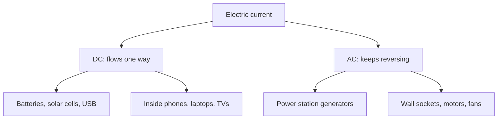

---

## 1. A Quick Refresher

| Term | Simple meaning |
|---|---|
| **Current** | The flow of electric charge (electrons) through a conductor. More electrons per second means more current. Measured in **amps (A)**. |
| **Voltage** | The "push" that makes the current flow. Measured in **volts (V)**. |
| **Polarity** | Which side is positive and which is negative. It defines the positive direction. |
| **Conventional current** | The standard way to draw current: from **+ to −**. |
| **Electron flow** | What physically happens: electrons move from **− to +**. |

**How a battery drives a current:** a battery creates a potential difference between its terminals. The negative terminal has an excess of electrons and the positive terminal has a shortage. Once the circuit is complete, electrons move from the negative terminal, through the load (for example a bulb), and back to the positive terminal. The flow continues for as long as the battery can maintain the difference.

> **A naming quirk:** the letters "AC" and "DC" stand for *current*, but they are used for *voltage* too. **AC voltage or current changes. DC voltage or current is steady in direction.** So "an AC voltage source" and "a DC current" are both normal phrases.

---

## 2. Direct Current (DC)

**DC is current that flows in one direction only**, like a calm river flowing steadily downhill. The electric charge keeps moving forward and never reverses.

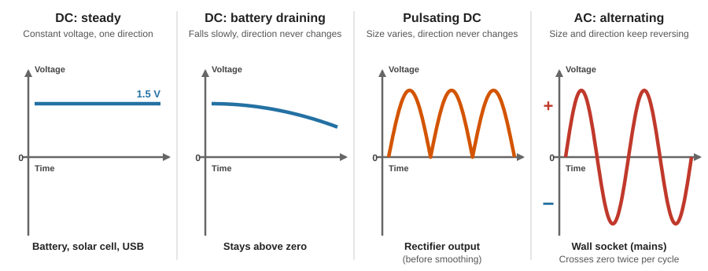

**Example: an AA battery and a toy motor.** A standard AA (LR6) battery gives **1.5 V**. Put it in a circuit with a DC motor (like in a toy car) and current flows in a single direction, turning the motor.

| Question | Answer |
|---|---|
| What does a voltage-time graph look like? | A flat, horizontal line, because the voltage stays constant. |
| What happens as the battery runs down? | The voltage **slowly falls** (the line slopes down), but the **polarity never changes**. |
| What if I turn the battery around? | The polarity reverses, so the current flows the opposite way and the **motor spins the opposite way**. |

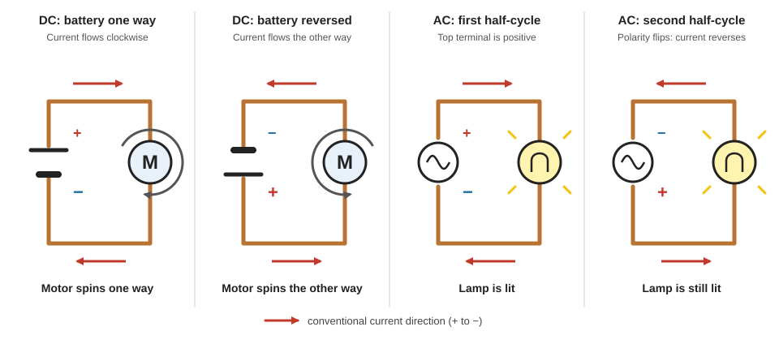

**DC does not have to be perfectly flat.** What matters is the **direction**, not whether the size changes. A battery's voltage droops, and the output of a rectifier (see [section 7](#7-converting-between-ac-and-dc)) pulses, but both are still DC because the current never reverses.

**Common DC sources and uses**

| Sources | Devices that run on DC |
|---|---|
| Batteries (the most common source), solar cells, fuel cells | Torches, wall clocks, toys, TV remotes, mobile phones, laptops, computers, LEDs, electric vehicles |

---

## 3. Alternating Current (AC)

**AC is current whose direction keeps changing.** Electrons move one way for a short time, then reverse and move the other way, and this repeats continuously. Think of the **tide** going in and out. This is the type of electricity that powers homes, schools and industry.

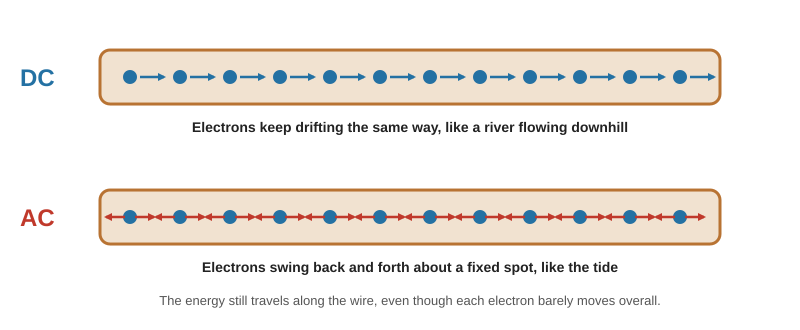

> In AC the electrons do not travel in a continuous loop from the power station to your lamp. They shuffle back and forth around a position, and the **energy** is what travels along the wire.

### 3.1 What happens in an AC circuit

Take a lamp plugged into a wall socket:

1. The voltage rises from zero, so the lamp gets brighter.
2. The voltage reaches its **peak** and then starts to fall, so the lamp gets dimmer.
3. At **0 V** the voltage's **polarity flips**, so the current flows the **opposite** way.
4. The voltage rises toward a peak in the new direction, so the lamp brightens again, then dims.

The lamp's brightness pulses twice for every full cycle, but it happens so fast that our eyes see steady light. (Incandescent bulbs really do pulse many times every second.)

### 3.2 The sine wave

The voltage of mains AC follows a smooth **sine wave** (a sine or cosine shape):

- The **positive** part of the wave means one terminal is positive.
- The **negative** part means the same terminal has become negative.
- **In one cycle the polarity changes twice**, and the current reverses with it.

| Mains frequency | Cycles per second | Polarity reversals per second |
|---|---|---|
| **60 Hz** (for example the US) | 60 | **120** |
| **50 Hz** (for example Europe) | 50 | **100** |

The shape can be written as a formula, where **V_peak** is the maximum voltage, **f** is the frequency and **t** is time:

> **v(t) = V_peak × sin(2π × f × t)**   (the same form works for current)

**Where AC comes from:** generators (alternators) at power stations naturally produce sine-wave AC.

---

## 4. Describing an AC Signal

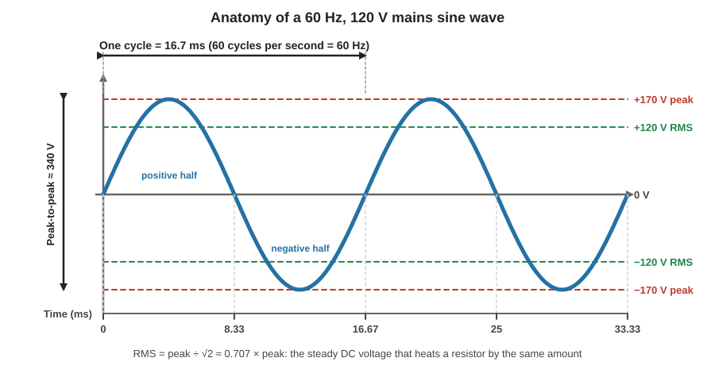

| Term | Simple meaning | Example (120 V, 60 Hz mains) |
|---|---|---|
| **Cycle** | One complete trip from a starting point to the same point again | One up-and-down of the wave |
| **Period (T)** | The time one cycle takes | 16.7 ms |
| **Frequency (f)** | How many cycles happen per second | 60 cycles per second |
| **Hertz (Hz)** | The unit of frequency: cycles per second | 60 Hz |
| **Peak** | The maximum voltage of the wave | ≈ 170 V |
| **Peak-to-peak** | From the top peak to the bottom peak (2 × peak) | ≈ 340 V |
| **RMS** | The **DC-equivalent** value: the steady DC voltage that would heat a resistor by the same amount | 120 V |

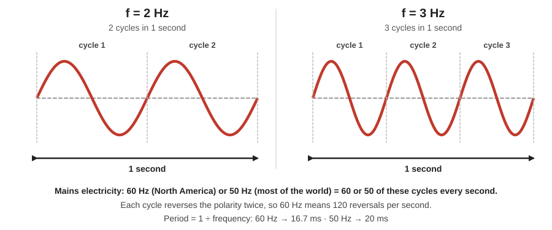

### 4.1 Peak vs RMS: the numbers you will actually use

When a voltage is quoted as "120 V AC", it is the **RMS** value unless it says otherwise. For a sine wave:

| Relationship | Formula |
|---|---|
| Peak from RMS | V_peak = V_RMS × √2 (about × 1.414) |
| RMS from peak | V_RMS = V_peak × 0.707 |
| Peak-to-peak | 2 × V_peak |
| Period from frequency | T = 1 ÷ f |

| Mains (RMS) | Peak | Peak-to-peak | Frequency | Period |
|---|---|---|---|---|
| 120 V | ≈ 170 V | ≈ 339 V | 60 Hz | 16.7 ms |
| 230 V | ≈ 325 V | ≈ 651 V | 50 Hz | 20 ms |

**Why this matters:** a 120 V AC supply swings up to about 170 V. A circuit that rectifies it into DC and smooths it with a capacitor can end up holding roughly **170 V DC**, the peak. A bulb designed for 120 V that is fed 170 V DC would receive about **double the power** (power ∝ V²; (170 ÷ 120)² ≈ 2), so it would be overloaded.

### 4.2 Mains voltage and frequency around the world

Different regions use different standards. The two common combinations are listed in the international standard IEC 60038.

| Region | Nominal voltage | Frequency |
|---|---|---|
| North America (US, Canada, Mexico) | 120 V | 60 Hz |
| Most of the world, including the UK, Europe and Australia | 230 V | 50 Hz |
| Japan | 100 V | 50 Hz (east, including Tokyo) and 60 Hz (west, including Osaka) |

Other combinations exist (for example 230 V at 60 Hz), so **always check the label** on a device before plugging it into a different country's supply.

---

## 5. Reading a Device Label

Look at your charger. The manufacturer's label states what it is designed to handle.

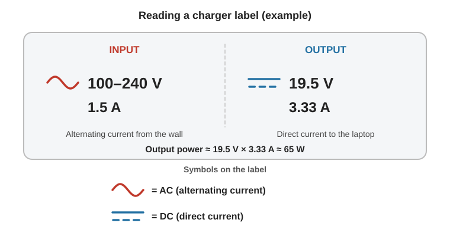

| | **Input** | **Output** |
|---|---|---|
| **Symbol** | ~ (AC) | solid over dashed line (DC) |
| **Voltage** | 100 to 240 V | 19.5 V |
| **Current** | 1.5 A | 3.33 A |
| **Type** | Alternating current from the wall | Direct current to the laptop |

The charger converts the wall's AC into a lower DC voltage. The **output power** is 19.5 V × 3.33 A ≈ **65 W**. Because the input range is 100 to 240 V, this charger can run from either the 120 V or the 230 V mains (it just needs the right plug).

---

## 6. Why the Power Grid Uses AC

### 6.1 The key idea: high voltage, low current

Power is **P = V × I**. To send the same power, you can use a high voltage with a **low current**, or a low voltage with a **high current**. The wires waste energy as heat, and that loss depends on the **current squared**:

> **Power lost in the wires = I² × R**

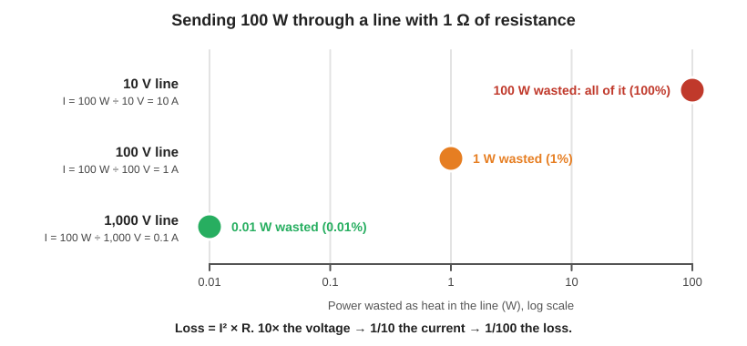

| Voltage | Current for 100 W | Heat lost in a 1 Ω line | Share lost |
|---|---|---|---|
| 10 V | 10 A | 100 W | 100% (nothing arrives) |
| 100 V | 1 A | 1 W | 1% |
| 1,000 V | 0.1 A | 0.01 W | 0.01% |

**Raise the voltage 10× and the current drops to 1/10, so the heat loss drops to 1/100.** Raise it 20× and the loss falls by **400×**. This is a simplified calculation (it ignores the voltage lost along the line), but it shows why power companies use very high voltages.

You cannot fix a low-voltage line just by using thicker wire: there is a limit to how thick a cable can be before it becomes too heavy or too expensive.

### 6.2 Why that favours AC

An **ideal transformer** passes the same power from input to output, so if it steps the voltage **up** by 20×, the current comes **down** by 20×. Transformers only work with AC. So with AC you can:

1. **Step up** the voltage at the power station for transmission,
2. **Step down** the voltage near homes so it is safe and usable.

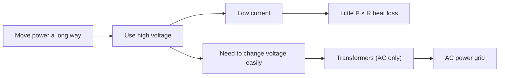

Edison's early DC system could not change voltage easily, so each DC power plant could only serve customers within about a mile or two, because the low-voltage, high-current lines lost too much power over distance.

### 6.3 The journey from power station to socket

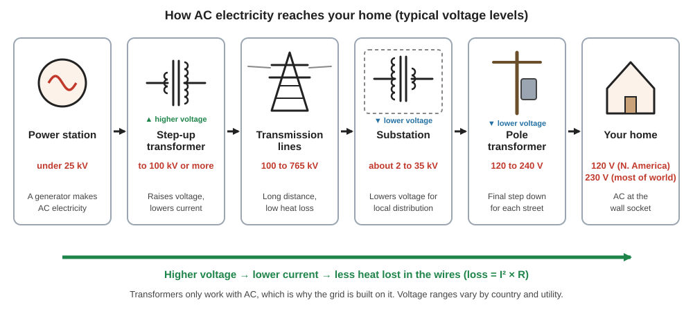

| Stage | What happens | Typical voltage |
|---|---|---|
| **Power station** | A generator produces AC | Under 25 kV |
| **Step-up transformer** | Raises the voltage for transmission | To 100 kV or more |
| **Transmission lines** | Carry large amounts of power over long distances | 100 kV and above (up to 765 kV in some systems) |
| **Substation and distribution lines** | The voltage is lowered for local distribution | About 2 to 35 kV |
| **Pole or pad transformer** | A final step down for homes | 120 to 240 V |
| **Your home** | AC at the wall socket | 120 V or 230 V |

*(Exact voltages vary by country and utility.)*

### 6.4 Is DC ever used for transmission?

**Yes.** Transmission today is mostly AC, but **high-voltage direct current (HVDC)** lines exist.

| Fact | Detail |
|---|---|
| **Where HVDC is used** | Very long distances, undersea cables, and links between two separate AC grids |
| **How it works** | A converter station changes AC to DC for the trip, and another changes it back to AC at the destination |
| **The trade-off** | The converter equipment is complex and expensive and adds its own losses, so HVDC mostly makes sense only for long or special routes |
| **Scale** | More than 100 HVDC projects exist around the world |

Modern electronics can now convert DC voltages too, which is part of why DC is making a comeback in solar power, batteries and electric vehicles.

---

## 7. Converting Between AC and DC

### 7.1 Why electronics use DC

Most small electronic devices (laptops, phones, TVs) use **DC on their circuit boards**, because DC is **easier to control** and lets circuits be **smaller and more compact**. Digital circuits also rely on steady voltage levels (for example 0 V and 5 V standing for binary 0 and 1).

Many appliances use **both**. A washing machine uses **AC** for the motor that spins the drum, but its control board (settings, lights, timers, motor speed control) runs on **DC**.

### 7.2 The conversion chains

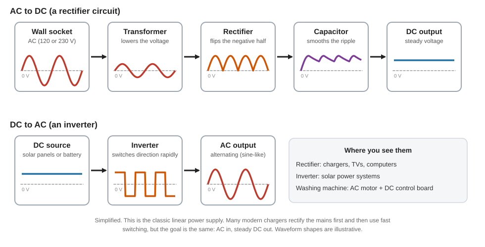

| Device | Converts | Where it is used |
|---|---|---|
| **Rectifier** | AC → DC | Chargers, TVs, computers. The "box" on a power cord is typically an AC-to-DC converter. |
| **Inverter** | DC → AC | Solar power systems (solar panels make DC; homes and the grid use AC) |

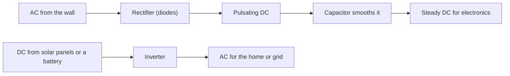

**How rectification works:** diodes let current flow one way only. A single diode (half-wave) passes only the positive half of the AC wave, giving rough, pulsating DC. Four diodes in a bridge (full-wave) pass both halves by flipping the negative one, which is smoother. A capacitor then fills the gaps between the peaks. A full-wave rectifier on 60 Hz mains pulses 120 times per second before smoothing. See the [Diodes guide](diodes.md) and the [Capacitors guide](capacitors.md) for the details.

### 7.3 Motors: AC or DC?

A motor runs on either type. What mostly decides how long it lasts is whether it has **brushes**. Brushed motors (often DC) wear out as the brushes wear, while **brushless** motors (the common AC induction type, and also brushless DC types) last longer. The brushless AC induction motor is common in large appliances such as washing machines, fans and air conditioners.

---

## 8. A Short History: The War of the Currents

| When | What happened |
|---|---|
| **Early years** | Edison's **direct current** was the standard in the US, but DC could not easily be converted to higher or lower voltages. |
| **Late 1880s** | Nikola Tesla promoted **alternating current**, which could be stepped up and down with a transformer. George Westinghouse backed AC. |
| **The campaign** | Edison, protecting his DC patent royalties, campaigned to discredit AC, spreading claims that it was more dangerous and publicly electrocuting animals with AC. |
| **1893** | At the Chicago World's Fair, General Electric bid $554,000 to light the fair with DC; Westinghouse won with a bid of $399,000 using AC. The same year, Westinghouse (who had licensed Tesla's AC induction motor patent) won the contract to harness Niagara Falls. |
| **1896** | On 16 November, Buffalo was lit by AC from Niagara Falls. General Electric then moved to AC too. |
| **Today** | The grid is mostly AC, but computers, LEDs, solar cells and electric vehicles run on DC, and HVDC is growing. The two now work side by side. |

---

## 9. Safety

| Point | Explanation |
|---|---|
| **Both can kill** | Danger depends on voltage, the current that flows through the body, the path it takes and how long it lasts. Neither AC nor DC is "safe". |
| **AC at mains frequency is especially effective** | 50 and 60 Hz AC is considered the most hazardous frequency range: it triggers strong involuntary muscle contractions and can disrupt the heart. |
| **DC is not harmless** | DC can also lock muscles so a person cannot let go, and high-voltage DC can be as dangerous as AC or worse. |
| **Danger is not just about AC vs DC** | Always judge the **voltage and current** involved, not the label. |
| **Stored energy** | Capacitors can hold a dangerous charge, even when disconnected. See the [Capacitors guide](capacitors.md). |
| **Do not copy demonstrations** | Online stunts with mains voltage are performed by experienced people and still go wrong. |
| **Get qualified help** | Only qualified, competent people should do mains electrical work. |

---

## 10. Detailed Comparison

| Feature | DC | AC |
|---|---|---|
| **Definition** | Charge flows in one direction | Charge flow reverses periodically |
| **Waveform** | Flat or slowly changing line (or pulsating, never reversing) | Usually a sine wave |
| **Polarity** | Fixed | Reverses each half-cycle |
| **Frequency** | 0 Hz | 50 or 60 Hz for mains |
| **Source** | Battery, solar cell, rectifier output | Generator (alternator) |
| **Voltage conversion** | Electronic DC-DC converters | Simple transformer |
| **Long-distance transmission** | Used as HVDC for special long or undersea links | Standard for most power grids |
| **Typical loads** | Electronics, LEDs, batteries, EVs | Motors, fans, heaters, lighting, large appliances |
| **Measured value** | Just the voltage | Usually the RMS value (with frequency) |

---

## 11. Common Misunderstandings

| Misunderstanding | What is actually true |
|---|---|
| "AC and DC only describe current." | The terms are used for **voltage** as well. |
| "In AC, electrons flow from the power station to my lamp." | They shuffle back and forth; the **energy** travels. |
| "120 V AC is always 120 V." | 120 V is the **RMS** value. The voltage actually swings up to about **170 V**. |
| "AC is dangerous and DC is safe (or the reverse)." | Both are dangerous. Voltage, current, path and duration matter. |
| "DC can't be sent over long distances." | **HVDC** does exactly that, but it needs expensive converter stations. |
| "DC lost the War of the Currents and disappeared." | Every phone, laptop, LED, solar panel and EV runs on DC. |
| "DC must be a perfectly flat line." | DC only needs a **constant direction**; its size can vary (pulsating DC). |
| "AC makes lamps visibly flicker." | The brightness pulses, but far too fast for the eye to notice. |

---

## 12. Glossary

| Term | Plain-English meaning |
|---|---|
| **AC** | Electricity whose direction keeps reversing |
| **DC** | Electricity that flows one way |
| **Mains** | The AC supply from the wall socket |
| **Sine wave** | The smooth up-and-down shape of mains voltage |
| **Cycle** | One full up-and-down of the wave |
| **Frequency / Hertz** | How many cycles per second / the unit for it |
| **Period** | The time one cycle takes |
| **Peak** | The highest voltage of the wave |
| **RMS** | The steady DC value that gives the same heating as the AC |
| **Transformer** | A device that raises or lowers an AC voltage |
| **Step-up / Step-down** | Raising / lowering voltage |
| **Rectifier** | Turns AC into DC |
| **Inverter** | Turns DC into AC |
| **HVDC** | High-voltage direct current transmission |
| **Load** | Whatever uses the power (a lamp, a motor) |

---

## 13. Test Yourself

| # | Question | Answer |
|---|---|---|
| 1 | How many times per second does the polarity reverse on a 60 Hz supply? | **120** (twice per cycle) |
| 2 | What is the period of 50 Hz AC? | 1 ÷ 50 = **20 ms** |
| 3 | What is the peak voltage of 230 V RMS mains? | 230 × 1.414 ≈ **325 V** |
| 4 | Why do power lines use very high voltage? | The same power needs **less current**, so there is far less **I² × R** heat loss. |
| 5 | If the line voltage is raised 20×, how much less power is wasted? | Current falls 20×, so the loss falls **400×**. |
| 6 | A label shows ~ on the input and a solid-and-dashed line on the output. What does the device do? | It **converts AC to DC** (a rectifier-type power supply). |
| 7 | Does reversing a battery in a DC motor circuit do anything? | Yes, the current reverses, so the **motor spins the other way**. |

---

## Quick Recap

- **DC** flows one way (batteries, solar cells, electronics). **AC** keeps reversing (the grid, wall sockets).
- AC voltage follows a **sine wave**. Its polarity flips **twice per cycle**; at 60 Hz that is **120 times per second**.
- Mains is quoted as **RMS**: 120 V RMS peaks near **170 V**; 230 V RMS peaks near **325 V**.
- The grid uses AC because **transformers** can raise the voltage, which lowers the current and cuts the **I² × R** loss.
- **HVDC** is used for very long and undersea links; **DC** dominates electronics, solar and batteries.
- **Rectifiers** turn AC into DC; **inverters** turn DC into AC.
- Both types are dangerous. Judge by voltage and current, and leave mains work to qualified people.

---

## Sources

### The videos this guide is built from

| Source | Used for |
|---|---|
| [AddOhms: AC vs DC Electricity](https://youtu.be/vN9aR2wKv0U?si=41t28kwwLGx1ngjH) | AC/DC terms applying to both voltage and current, battery and motor example, polarity, cycle and frequency, 50/60 Hz |
| [The Engineering Mindset: AC vs DC Electricity](https://youtu.be/2jqJZxxX6gQ?si=a75QmwAolT95qJp4) | Reading a charger label, AC and DC symbols, why the grid uses AC, why electronics use DC, appliances that use both, rectifiers and inverters |
| [Brain Station Advanced: AC vs DC Electricity](https://youtu.be/CCHGatqIkAI?si=KqrGtzrclOAYhrxF) | Current and potential difference, river analogy, DC graphs, the sine wave, polarity reversing twice per cycle, the AC formula, transformers and transmission |
| [ElectroBOOM: AC vs DC](https://youtu.be/S7C5sSde9e4?si=6_b_Cixyc_ECgvGh) | History, rectified peak voltage, transmission-line losses, the 20× voltage and 400× loss example, brush wear in motors |

### Further reading

| Source | What it adds |
|---|---|
| [U.S. Department of Energy: The War of the Currents: AC vs. DC Power](https://www.energy.gov/articles/war-currents-ac-vs-dc-power) | The history, the 1893 fair and Niagara contracts, and the modern comeback of DC |
| [PJM Learn: Transmission & Distribution](https://learn.pjm.com/electricity-basics/transmission-distribution) | Typical transmission and distribution voltage levels |
| [PJM: High Voltage Direct Current fact sheet (PDF)](https://www.pjm.com/-/media/DotCom/about-pjm/newsroom/fact-sheets/hvdc-fact-sheet.pdf) | Why and where HVDC is used, converter stations, number of projects |
| [PNNL: Distribution system infographic (PDF)](https://epe.pnnl.gov/pdfs/Distribution_system_infographic.pdf) | Distribution system voltages (typically up to 35 kV) and equipment |
| [Wikipedia: Mains electricity](https://en.wikipedia.org/wiki/Mains_electricity) | Voltage and frequency standards, IEC 60038, history |
| [Wikipedia: Mains electricity by country](https://en.wikipedia.org/wiki/Mains_electricity_by_country) | Country-by-country voltage, frequency and plug types |
| [All About Circuits: AC Waveforms](https://www.allaboutcircuits.com/textbook/alternating-current/chpt-1/ac-waveforms/) | Period and frequency, sine waves, other waveforms |
| [EEPower: Values of Alternating Voltage and Current](https://eepower.com/technical-articles/values-of-alternating-voltage-and-current/) | Peak, peak-to-peak and RMS values, with worked examples |
| [All About Circuits: Physiological Effects of Electricity](https://www.allaboutcircuits.com/textbook/direct-current/chpt-3/physiological-effects-electricity/) | How current affects the body, "can't let go" effect, AC frequency and hazard |

### Notes on accuracy

| Topic | How this guide handles it |
|---|---|
| **Which is more dangerous, AC or DC?** | The sources disagree on details. The guide says both are dangerous, that mains-frequency AC is especially effective at causing muscle lock-on and heart disruption, and that voltage and current matter more than the label. |
| **Edison's campaign** | Only the points confirmed by the Department of Energy are included (disinformation about AC and public electrocution of animals). Other well-known anecdotes were left out because they could not be confirmed here. |
| **Motors** | One video compares brushless AC with brushed DC. The guide notes that what matters is brushes, since brushless DC motors also exist. |
| **Lamp brightness on AC** | The brightness pulses twice per cycle, not once, which is why the "flashing" is faster than the mains frequency. |
| **Transmission example** | The 100 W loss table is a simplified illustration that ignores voltage drop along the line, and an ideal transformer was assumed. |
| **AC-to-DC chain** | The classic linear power-supply chain is shown. Many modern chargers rectify first and use fast switching, but the goal is the same. |
