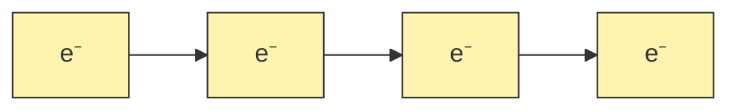
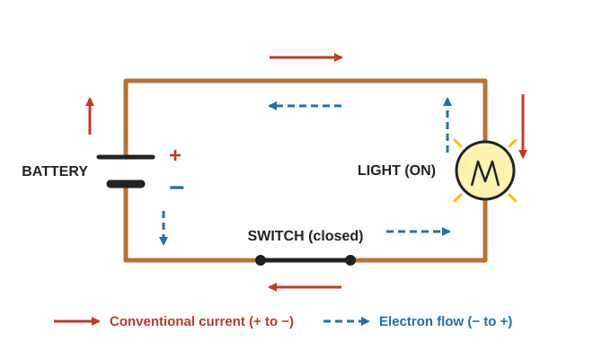
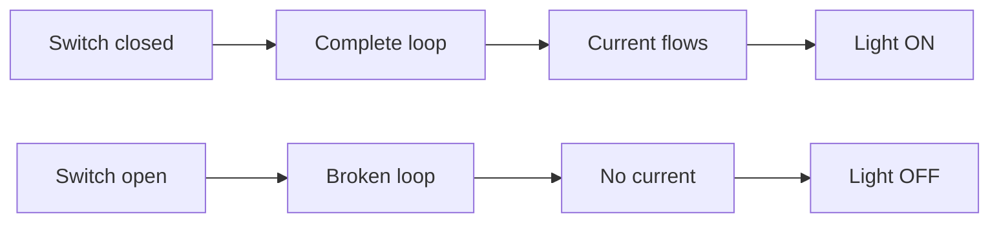
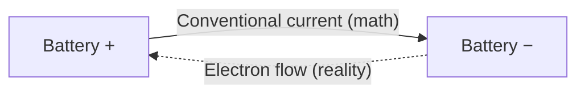

# Amps & Electric Current

> **In one line:** Electric current is the flow of electrons through a conductor, and it is measured in **amperes (amps, A)**.

---

## 1. Atoms and Charge

- Atoms have a **positive nucleus** and **negative electrons** around it.
- **Opposite charges attract. Same charges repel.**
- In most solids, electrons stay put. In **metals (like copper)**, electrons can drift from atom to atom.

| Charges | Result |
|---|---|
| + and − | Attract |
| − and − | Repel |
| + and + | Repel |

---

## 2. What Is Current?

When one electron is pushed into the next atom, it pushes the others too, like a **conga line**. Each electron moves only a tiny distance, but the push travels through the wire at close to the speed of light.

> **Current flowing = electrons flowing.**

---

## 3. Measuring Current: The Amp (A)

- **1 amp ≈ 6.24 × 10¹⁸ electrons per second** passing a point (no need to memorize).
- 2 amps = twice as many electrons flowing.
- **Water analogy:** current is like the amount of water flowing through a pipe per second.

| Water Pipe | Electric Circuit |
|---|---|
| Water flow | Electron flow (current) |
| Litres per second | Amps |
| Pipe | Wire |

---

## 4. Circuits

A **circuit** is a **closed loop** that current can flow around.

- **Closed circuit** → current flows → light **ON**
- **Open circuit** (broken loop) → no current → light **OFF**

Electrons cannot jump through the air, so a gap stops all flow and no energy is transferred.

---

## 5. Switches and Fuses

| Part | How it works |
|---|---|
| **Switch** | Two pieces of metal touch (closed, ON) or pull apart (open, OFF). |
| **Fuse** | A thin piece of metal that **melts** if current exceeds its rating. This opens the circuit and protects it from overload and fire. |

**Fuse example:** a 15 A fuse carrying 5 A is fine. At 30 A it melts and stops the current until it is replaced.

---

## 6. Conventional Current vs. Electron Flow

| | Direction | Used for |
|---|---|---|
| **Electron flow** | **− to +** (what really happens) | Physics reality |
| **Conventional current** | **+ to −** (historical guess) | **All electronics formulas and schematics** |

Early scientists guessed the direction wrong, but every formula is built on that guess and stays consistent. **Always use conventional current (+ to −) when doing circuit math.**

---

## Quick Recap

- Current = flow of electrons, measured in **amps (A)**.
- Current needs a **complete (closed) loop**.
- **Switches** open or close the loop. **Fuses** open it automatically when current is too high.
- Use **conventional current (+ to −)** in all calculations.

---

**Source:** [Basic Electricity series, Part 1: Amps (Afrotechmods)](https://youtu.be/8gvJzrjwjds?si=6AJP9WOZFUsWDIt0)
