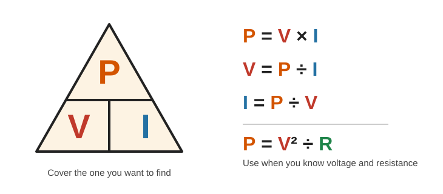
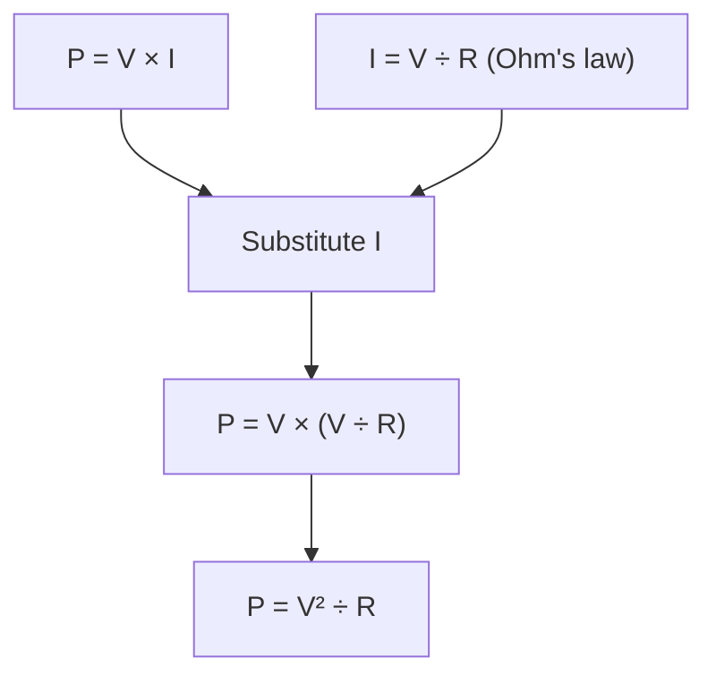
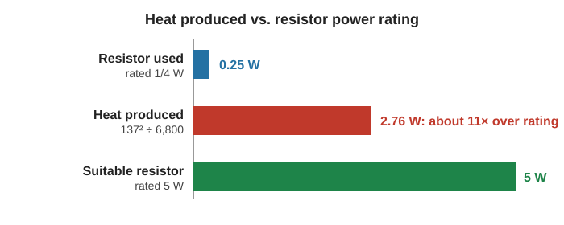

# Electrical Power & Watts

> **In one line:** Power is the **rate at which energy is supplied or used**, measured in **watts (W)**. Calculate it with **P = V × I**.

---

## 1. What Is Power?

| Term | Meaning | Unit |
|---|---|---|
| **Energy** | Ability to do work | Joule (J) |
| **Power** | Energy transferred **per second** | **Watt (W)** |

> **1 watt = 1 joule per second**

**Example: a small motor**

| Voltage | Current | Energy per second | Power |
|---|---|---|---|
| 1 V | 1.8 A | 1.8 J/s | **1.8 W** |
| 2 V | 2 A | 4 J/s | **4 W** |

More power means more work per second, so the motor spins faster.

---

## 2. The Power Formula

> **Power = Voltage × Current**  (P = V × I)

| Symbol | Quantity | Unit |
|---|---|---|
| **P** | Power | Watts (W) |
| **V** | Voltage | Volts (V) |
| **I** | Current | Amps (A) |

**Real example: a "40 W" light bulb on a 120 V outlet**

| Measured | Value |
|---|---|
| Voltage | 119.6 V |
| Current | 337 mA = 0.337 A |
| Power | 119.6 × 0.337 ≈ **40.3 W** |

The bulb converts about 40.3 joules into light and heat every second.

> ⚠️ **Safety:** Mains electricity is dangerous. Do not measure or experiment with wall outlets at home.

---

## 3. Voltage AND Current Both Matter

Different combinations of voltage and current can give the **same power**:

| Design | Voltage | Current | Power |
|---|---|---|---|
| Mains bulb | 120 V | low (≈ 0.34 A) | ≈ 40 W |
| 12 V LED lighting | 12 V | about 10× more | ≈ 40 W |

- LEDs are more efficient, so the same watts give **more light**.
- Low voltage is not always better. A high-power robot may be **more efficient with a higher battery voltage**.

---

## 4. Power in a Resistor: P = V² ÷ R

To find the power delivered to a resistor when you know only **voltage** and **resistance**, combine two formulas:

The power delivered to a resistor is released as **heat**.

---

## 5. Why the Resistor Burned Out

Setup: 140 V supply, white LED (3 V drop), 6.8 kΩ resistor.

| Step | Calculation | Result |
|---|---|---|
| Voltage across resistor | 140 V − 3 V | **137 V** |
| Power as heat | 137² ÷ 6,800 | **≈ 2.76 W** |
| Resistor's rating | | **1/4 W (0.25 W)** |

The resistor had to dissipate about **11× its rating**, so it overheated and burned.

**Fix:** use a resistor with a higher power rating (for example, **5 W**), which is physically larger and sheds heat better.

---

## 6. Power Ratings

Nearly every component has a **power rating**: the most power it can handle before failing.

| Component | What the rating means |
|---|---|
| Resistors | Max heat they can dissipate |
| Diodes, transistors | Listed in the **datasheet** |
| Light bulbs, heaters, microwaves | Energy converted per second |

---

## 7. What This Means for Home Projects

Most beginner circuits use **12 V or less** and a **few milliamps**. Standard **1/4 W resistors** are enough for almost everything, **as long as you choose the right resistance value**.

**Check using the LED circuit from the previous topic** (9 V battery, white LED, 330 Ω resistor):

> P = V² ÷ R = 6² ÷ 330 ≈ **0.11 W**, comfortably under 0.25 W

**Rule of thumb:** calculate the resistor's power (P = V² ÷ R) and make sure it is **below the resistor's rating**.

---

## Quick Recap

- **Power = rate of energy use**; **1 W = 1 J/s**.
- **P = V × I**
- **P = V² ÷ R** (when you know voltage and resistance)
- Power in a resistor becomes **heat**.
- Always compare calculated power to the part's **power rating**.
- Low-voltage hobby circuits usually work fine with **1/4 W resistors**.

---

**Source:** [Basic Electricity series, Part 5: Electrical Power & Watts (Afrotechmods)](https://youtu.be/VSpB3HivkhY?si=pb6T4xsVIEp7gBu7)
