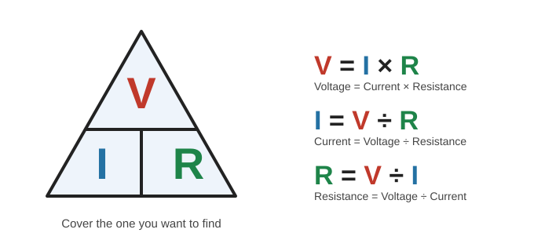
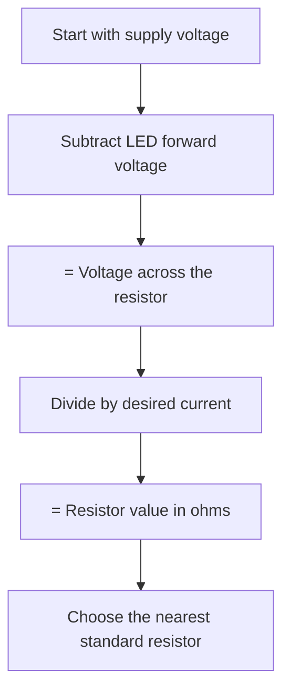
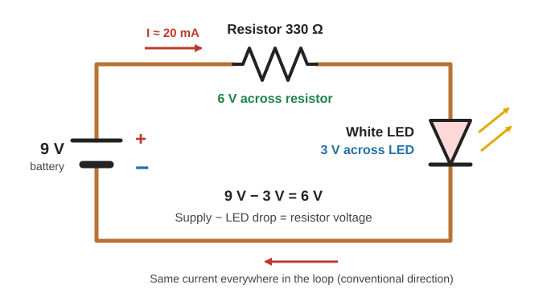

# Resistance & Ohm's Law

> **In one line:** Resistance opposes current flow. **Ohm's law (V = I × R)** links voltage, current, and resistance, and lets you pick the right resistor to limit current, for example in an LED circuit.

---

## 1. What Is Resistance?

**Resistance** is how strongly a material opposes the flow of current. A **resistor** is a component that adds a controlled amount of resistance to a circuit.

**Why it happens:**
- Atoms in a material are always vibrating slightly (heat).
- Moving electrons bump into atoms, and some of their movement energy turns into **heat**.
- This is how **electric heaters** and **incandescent bulbs** work.
- Some materials also have few free electrons or a poor atomic arrangement, so current flows poorly.

**Metals have the least resistance.** Almost everything has some.

**Common resistor types:**

| Type | Typical use |
|---|---|
| Standard through-hole | Hobby and home circuits |
| Surface-mount (tiny) | Phones and compact devices |
| Large power resistor | Power supplies |

---

## 2. Measuring Resistance: The Ohm (Ω)

| Resistance | Meaning | Example |
|---|---|---|
| **Under 1 Ω** | Very low | Wire (good conductor) |
| **1 MΩ (1,000,000 Ω)** | Very high | Dried-out carrot (poor conductor) |

A **multimeter** measures resistance.

| Prefix | Meaning |
|---|---|
| Ω | ohms |
| kΩ (kilo-ohm) | × 1,000 Ω |
| MΩ (mega-ohm) | × 1,000,000 Ω |

---

## 3. Reading Resistor Colour Bands

Colour bands encode the value. Use a **resistor colour calculator** (web or phone app) instead of memorizing.

| Band | Meaning |
|---|---|
| **1st & 2nd** | The first two digits |
| **3rd** | Multiplier (× 10ⁿ) |
| **4th** | Tolerance (accuracy) |

| Colour | Digit |
|---|---|
| Black | 0 |
| Brown | 1 |
| Red | 2 |
| Orange | 3 |
| Yellow | 4 |
| Green | 5 |
| Blue | 6 |
| Violet | 7 |
| Grey | 8 |
| White | 9 |

**Examples:**

| Bands | Calculation | Value |
|---|---|---|
| Red, Violet, Brown, Gold | 2 7 × 10 | **270 Ω** (±5%) |
| Brown, Black, Red, Gold | 1 0 × 100 | **1,000 Ω (1 kΩ)** (±5%) |

**Tolerance:** a real 1 kΩ resistor with ±5% tolerance may measure anywhere from about 950 Ω to 1,050 Ω. That is good enough for most home circuits.

---

## 4. Ohm's Law

| Symbol | Quantity | Unit |
|---|---|---|
| **V** | Voltage | Volts (V) |
| **I** | Current | Amps (A) |
| **R** | Resistance | Ohms (Ω) |

All three forms are the **same equation** rearranged.

**Example:** 10 V source, limit current to 10 mA (0.01 A):

> R = V ÷ I = 10 ÷ 0.01 = **1,000 Ω**

**Ohm's law is linear:** for a fixed resistor, **double the voltage → double the current.**

| Voltage | Resistor | Current |
|---|---|---|
| 10 V | 1 kΩ | 10 mA |
| 20 V | 1 kΩ | 20 mA |

> ⚠️ **Only pure resistors follow Ohm's law.** Most other components (LEDs, ICs, etc.) behave in more complicated ways. They may work fine up to a rated voltage and then fail suddenly beyond it.

---

## 5. Choosing a Resistor for an LED

**Formula:**

> **R = (Supply voltage − LED forward voltage) ÷ Desired current**

**Worked example:** 9 V battery, white LED (forward voltage 3 V), target current 20 mA (0.02 A):

| Step | Calculation | Result |
|---|---|---|
| Voltage across resistor | 9 V − 3 V | **6 V** |
| Resistor value | 6 V ÷ 0.02 A | **300 Ω** |
| Nearest available value | | **330 Ω** |

- A 330 Ω resistor gives about 18 mA, which is close enough. Being off by 10% doesn't matter for LEDs at home.
- Use **conventional current** (+ to −) in the calculations.
- **Resistor direction does not matter** (unlike an LED, which has polarity).
- **Bigger resistor → less current → dimmer LED** (for example, 18 kΩ gives a much dimmer LED).

**Wiring order:** battery (+) → resistor → LED anode → LED cathode → battery (−).

---

## 6. Limitation: Resistors Get Hot

The formula gives the right **current**, but it does not check whether the resistor can **handle the heat**.

Example: 140 V supply, white LED (3 V), 20 mA:

> R = (140 − 3) ÷ 0.02 = **6,850 Ω** (a 6.8 kΩ resistor is very close)

The LED is protected, but the **resistor overheats**. Each resistor has a limit on how much heat it can safely dissipate. This is a matter of **electrical power**, the next topic to learn.

> ⚠️ **Safety:** 140 V is dangerous. Do not experiment with high voltages at home.

---

## Quick Recap

- **Resistance** opposes current and is measured in **ohms (Ω)**.
- Read resistors by **colour bands** (use a calculator). The 4th band is **tolerance**.
- **Ohm's law: V = I × R**, rearranged as I = V ÷ R and R = V ÷ I.
- **LED resistor: R = (Supply − LED voltage) ÷ Current.**
- Resistor polarity doesn't matter. LED polarity does.
- Resistors turn energy into **heat**, so heat (power) limits matter too.

---

**Source:** [Basic Electricity series, Part 4: Resistance & Ohm's Law (Afrotechmods)](https://youtu.be/NfcgA1axPLo?si=hzjwXIABNUjTW88t)
