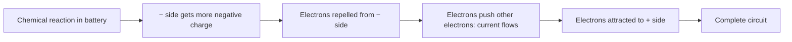
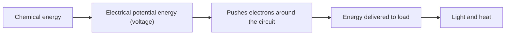

# Volts & Voltage

> **In one line:** Voltage is the "push" that makes current flow. Precisely, it is the **difference in electrical potential energy per unit of charge between two points**, measured in **volts (V)**.

---

## 1. What Voltage Does

Voltage acts like a **pushing force** on electrons. It starts them moving around a circuit, which creates current.

> **More voltage = more push = more current.**

Example with a small motor:

| Voltage | Current | Result |
|---|---|---|
| 0 V | 0 A | Motor does nothing |
| 1 V | ≈ 1.8 A | Motor turns |
| 2 V | ≈ 2 A | Motor turns faster |

**Two common uses of voltage:**

| Use | Current drawn | Example |
|---|---|---|
| **Power** | High | Motors, light bulbs, electronics |
| **Signal (data)** | Almost none | 0 V = binary 0, 5 V = binary 1 |

---

## 2. Where the Push Comes From

A battery uses a **chemical reaction** to build up charge on its terminals:

---

## 3. Key Definitions

| Term | Meaning | Unit |
|---|---|---|
| **Energy** | Ability to do work (move or heat something) | Joule (J) |
| **Potential energy** | Stored energy with the *potential* to do work (stretched elastic, battery) | Joule (J) |
| **Charge** | Amount of electric charge | Coulomb (C) |
| **Current** | Charge flowing per second | Amp (A) |
| **Voltage** | Energy transferred per coulomb of charge | Volt (V) |

**Useful numbers:**
- **1 coulomb** = the charge of about **6.24 × 10¹⁸ electrons**
- **1 amp = 1 coulomb per second**
- **1 joule** powers a flashlight for about 1 second

---

## 4. The Core Relationship

> **1 volt = 1 joule per coulomb**

A 1.5 V battery transfers **1.5 joules of energy** for every coulomb of charge that flows. That energy is delivered to the load (for example, a light bulb) and converted into light and heat.

---

## 5. Energy Flow: Worked Example

**Energy per second = volts × amps**

| Voltage | Current | Calculation | Energy flowing per second |
|---|---|---|---|
| 1 V | 1.8 A | 1 × 1.8 | **1.8 joules/s** |
| 2 V | 2 A | 2 × 2 | **4 joules/s** |

More energy per second through the motor means more work done, so it spins faster.

---

## 6. Voltage Is Always Between Two Points

Voltage is **relative**. It only makes sense **between two points**, which is why it is also called **potential difference**.

| Casual phrase | What it really means |
|---|---|
| "A 9 V battery" | 9 V of potential difference between the − and + terminals |
| "A 5 V USB port" | 5 V between the positive power pin and the negative power pin |
| "3.3 V data signal" | A changing 3.3 V between two data pins |

**Other names for voltage:** potential difference, electrical tension.

---

## Quick Recap

- Voltage **pushes** current around a circuit.
- **Higher voltage → more current → more energy per second.**
- **1 V = 1 J per coulomb** of charge.
- **1 A = 1 coulomb per second.**
- Voltage is **always measured between two points**.
- Voltage can **power** things (high current) or **carry signals** (almost no current).

---

**Source:** [Basic Electricity series, Part 2: Volts (Afrotechmods)](https://youtu.be/TBt-kxYfync?si=5gD9Nea12HrnOMQW)
