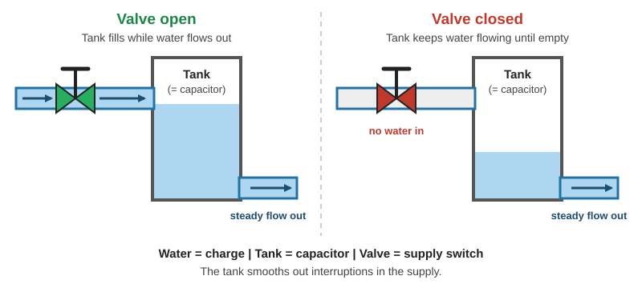
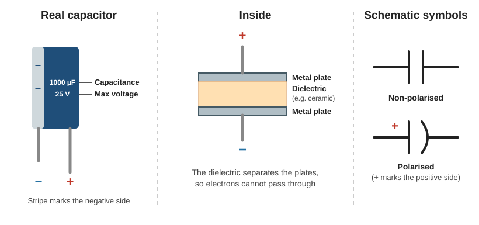
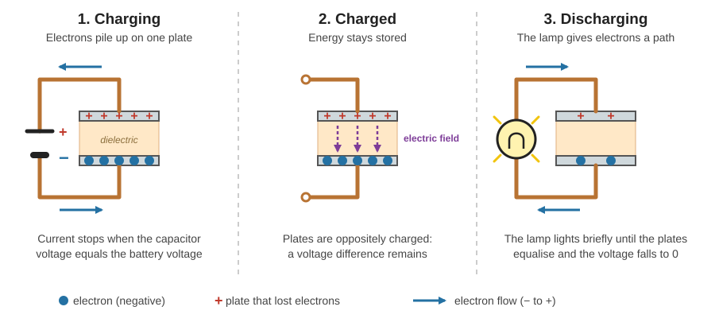
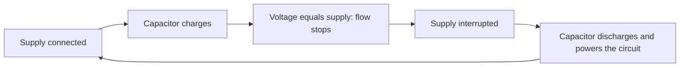
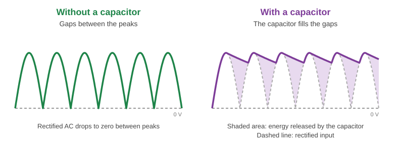
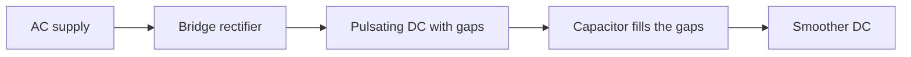
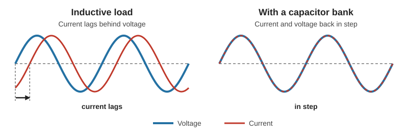
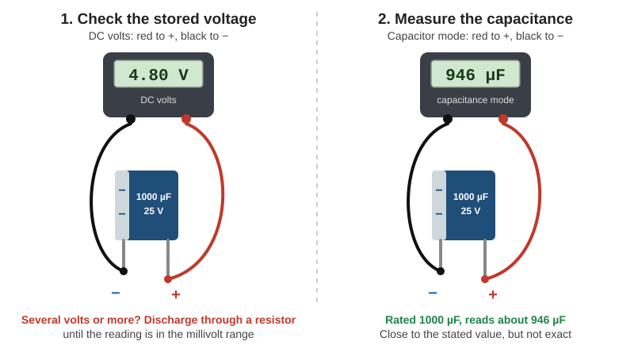
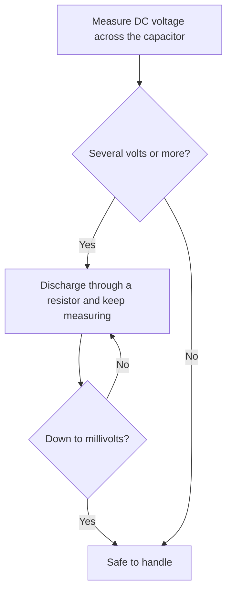

# Capacitors

> **In one line:** A capacitor **stores electric charge** and can release it very quickly. It is used to **smooth out interruptions** in a supply and appears on almost every circuit board.

> ⚠️ **Safety first:** Electricity is dangerous and can be fatal. Only work on electrical equipment if you are qualified and competent. **Never touch the terminals of a capacitor**: it can hold a charge and give you an electric shock.

---

## 1. What Is a Capacitor?

A capacitor is a little like a battery, but it stores energy in a different way.

| | **Capacitor** | **Battery** |
|---|---|---|
| **What it stores** | Electric charge | Energy (chemically) |
| **Capacity** | Stores **less** energy | Stores **more** energy |
| **Charge / release speed** | **Very fast** | Slower |
| **Typical job** | Smoothing, short bursts of power | Long-term power supply |

**Water tank analogy**

| Water system | Electrical circuit |
|---|---|
| Water | Charge |
| Tank | **Capacitor** |
| Valve | Supply switch (on/off) |
| Steady flow out while the valve is closed | Power kept up during an interruption |

- With the valve open, water flows on **and** fills the tank.
- When the valve closes, the tank **keeps the water flowing** until it empties.
- As long as the tank is never completely emptied, the supply out is **uninterrupted**.

**In a circuit:** if you switch a simple circuit on and off very fast **without** a capacitor, the light **flashes**. With a capacitor in the circuit, the light **stays on** during the interruptions (for a short time) because the capacitor discharges and powers the circuit.

---

## 2. Inside a Capacitor

| Part | What it is |
|---|---|
| **Two metal plates** | Conductive, typically aluminium |
| **Dielectric** | An insulating material between the plates, such as ceramic. "Dielectric" means it **polarises** (its charges shift) when in an electric field. |
| **Leads** | One side connects to the **positive** side of the circuit, the other to the **negative** |
| **Stripe and symbol** | Printed on the side to mark the **negative** side |

The plates never touch. The dielectric stops electrons passing **through** the capacitor.

---

## 3. How a Capacitor Works

| Stage | What happens |
|---|---|
| **1. Charging** | The battery's voltage pushes electrons from its negative terminal toward the capacitor. They **build up on one plate**, while the other plate releases some electrons. Electrons can't cross the insulator, so they pile up. |
| **Fully charged** | The capacitor reaches the **same voltage as the battery**. No more electrons flow. |
| **2. Charged and disconnected** | One plate has extra electrons (negative), the other has too few (positive), so there is a **voltage difference**. It stays even after the battery is removed, and you can measure it with a multimeter. |
| **3. Discharging** | Connect a lamp and electrons have a path to the other plate. They flow **through the lamp**, powering it. This lasts a short time, until both plates equalise. The voltage is then **zero**, so there is no push and no flow. |

Reconnect the battery and the capacitor **charges again**. This is how it can cover interruptions in the supply.

**Why the stored charge stays: the electric field**

Opposite charges attract (like magnets). The extra electrons on one plate are pulled toward the positively charged particles on the opposite plate. They can **never reach each other** because of the dielectric. This pull is an **electric field**, and it holds the electrons in place until another path (such as a lamp) lets them flow.

**Voltage as a difference (pressure analogy)**

Voltage is like pressure: it is always measured **between two points**.

| Measurement | Reading |
|---|---|
| Across a 1.5 V battery (one end to the other) | **1.5 V** |
| Same end to the same end | **0 V** (no difference) |
| Across a charged capacitor | A voltage (electrons built up on one plate) |
| Across a fully discharged capacitor | **0 V** (like an empty tank: nothing to compare) |

---

## 4. Reading a Capacitor

On the side of the capacitor you will find **two values**:

| Value | Meaning | Unit | Symbol |
|---|---|---|---|
| **Capacitance** | How much charge it can store | **Farads (F)**, usually measured in **microfarads** | µF |
| **Voltage** | The **maximum voltage** the capacitor can handle | Volts | V |

- 1 farad = 1,000,000 microfarads (µF).
- **Never exceed the voltage rating.** Beyond it, the capacitor can **explode**.

---

## 5. Where and Why We Use Capacitors

**Where you will find them**

| Size | Typical use |
|---|---|
| **Small** | On circuit boards (almost every board) |
| **Larger** | Induction motors, ceiling fans, air conditioning units |
| **Very large** | Correcting poor power factor in large buildings |

### 5.1 Smoothing AC converted to DC

A full-wave (bridge) rectifier **flips** the negative half of the AC sine wave so it flows in the positive direction. This tricks the circuit into thinking it is getting direct current, but there are **gaps between the peaks**.

A capacitor **charges at each peak** and **releases energy into the gaps**, smoothing the supply to look more like DC. *(For how the rectifier itself works, see the [Diodes guide](diodes.md).)*

### 5.2 Power factor correction

When **too many inductive loads** (such as motors) are on a circuit, the **current lags behind the voltage**: the two waveforms fall out of sync. **Capacitor banks** counteract this and bring them back into alignment.

| | Without correction | With capacitor bank |
|---|---|---|
| **Current vs. voltage** | Current lags | Back in step |

---

## 6. Measuring a Capacitor with a Multimeter

> ⚠️ A capacitor can hold **high voltage for a long time, even when disconnected**. Always check the voltage **before** handling it.

### 6.1 Check the stored voltage (do this first)

| Step | Action |
|---|---|
| 1 | Set the meter to **DC voltage** |
| 2 | **Red** probe to the **positive** side, **black** probe to the **negative** side |
| 3 | Read the voltage |
| 4 | **Several volts or more?** Discharge it safely by connecting the terminals **through a resistor**, and keep reading |
| 5 | Continue until the reading is in the **millivolt range** before handling it |

### 6.2 Measure the capacitance

*Not all multimeters have a capacitance function.*

| Step | Action |
|---|---|
| 1 | Switch the meter to the **capacitor (capacitance) function** |
| 2 | **Red** probe to **positive**, **black** probe to **negative** |
| 3 | Wait a **short delay**, then read the value |

**Expect a value close to, but not exactly, the stated rating:**

| Rated | Measured | Difference |
|---|---|---|
| 1,000 µF | ≈ 946 µF | about 5% lower |
| 33 µF | ≈ 36 µF | about 9% higher |

---

## Quick Recap

- A capacitor **stores charge** and releases it **fast**; it holds less energy than a battery.
- **Two metal plates + a dielectric (insulator)**. Electrons build up on one plate but can't cross.
- Charges until its voltage **equals the supply**; keeps that voltage when disconnected; **discharges** through a load until the voltage reaches zero.
- Marked with **capacitance (µF)** and **maximum voltage (V)**. Exceeding the voltage rating can make it **explode**. A stripe marks the **negative** side.
- Uses: **smoothing** rectified DC (filling the gaps between peaks) and **power factor correction** (bringing current back in step with voltage).
- **Check the voltage first, discharge through a resistor if needed**, then handle. Measured capacitance is close to, but not exactly, the rating.

---

**Source:** [Capacitors, How They Work (The Engineering Mindset)](https://www.youtube.com/watch?v=X4EUwTwZ110&list=PLWv9VM947MKi8KxDEki9x0FkQv3WBb2Ev&index=8)
