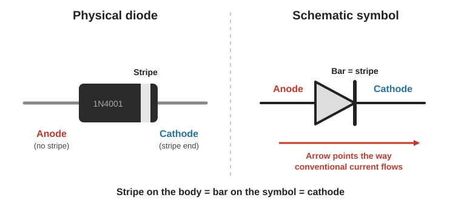
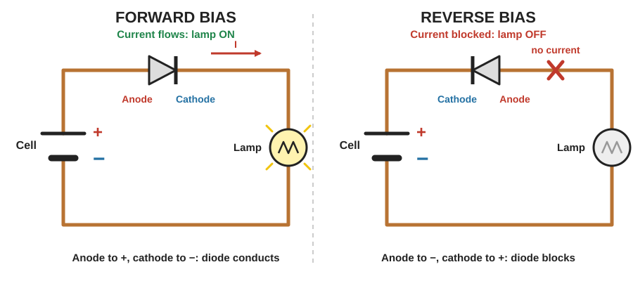
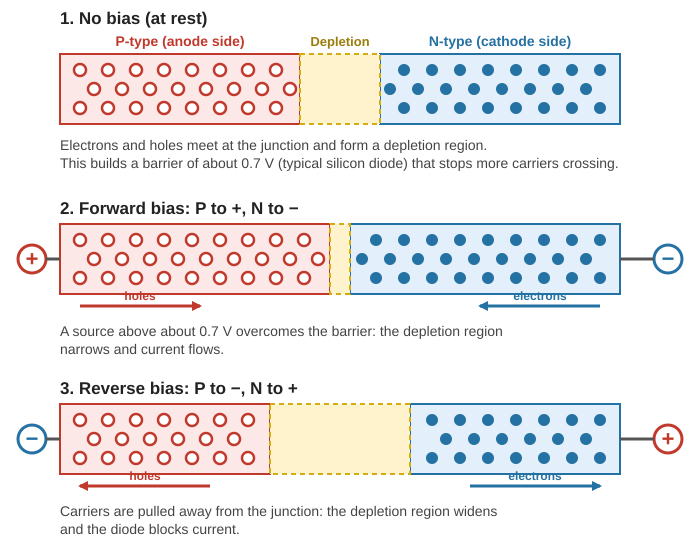
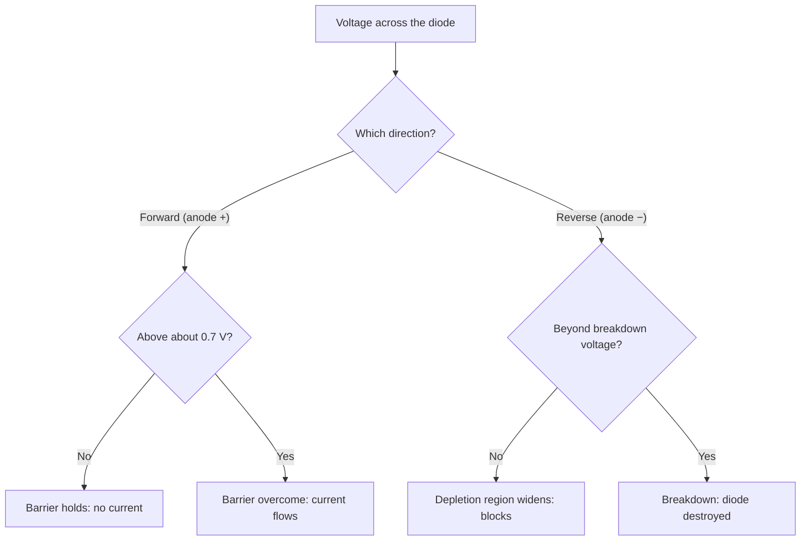
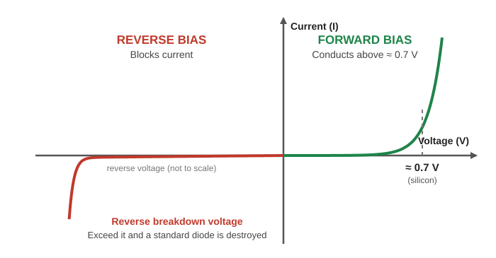
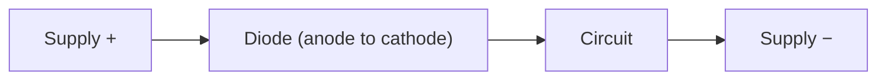
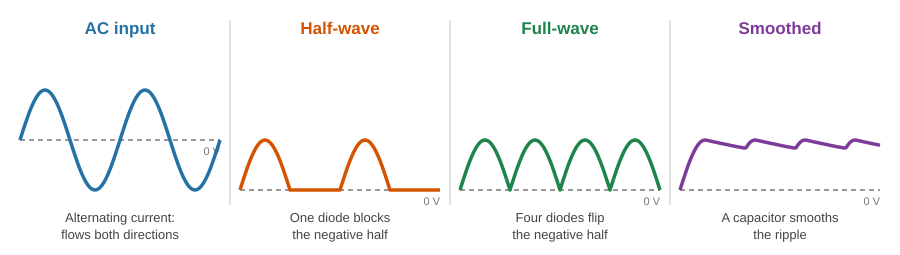
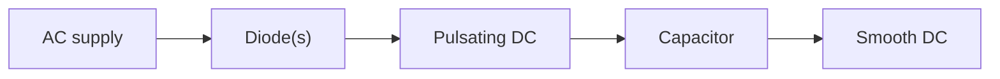
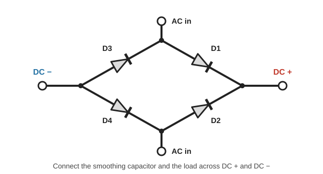
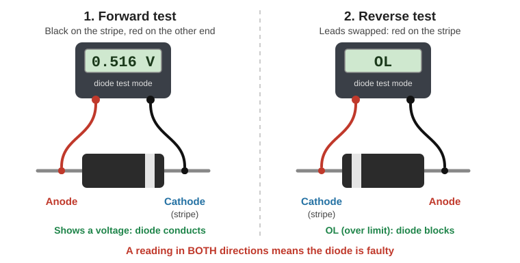

# Diodes

> **In one line:** A diode lets current flow in **one direction only**. It acts as a conductor when connected one way (forward bias) and as an insulator when connected the other way (reverse bias).

---

## 1. What Is a Diode?

A typical diode has a **black cylindrical body**, a **stripe at one end**, and a lead at each end for connecting it into a circuit.

| End | Name | How to spot it |
|---|---|---|
| **Anode** | Where conventional current enters | End **without** the stripe (the triangle side of the symbol) |
| **Cathode** | Where conventional current leaves | End **with** the stripe (the bar side of the symbol) |

**Other diode types** exist (such as the Zener diode and the LED, which emits light), but this guide covers the standard diode.

**Water analogy: a swing gate in a pipe.**
- Water flowing one way pushes the gate **open** and passes through.
- Water flowing the other way pushes the gate **shut** and is blocked.

A diode does the same for current, which is why diodes are used to **control the direction of current** in a circuit.

---

## 2. Forward Bias and Reverse Bias

| | **Forward bias** | **Reverse bias** |
|---|---|---|
| **Connection** | Anode to **+**, cathode (stripe) to **−** | Anode to **−**, cathode (stripe) to **+** |
| **Diode acts as** | Conductor | Insulator |
| **Current** | Flows | Blocked |
| **Lamp/LED in series** | ON | OFF |

> **Current direction:** *Electron flow* goes from − to + (what physically happens). *Conventional current* goes from + to − (the engineering standard, and the direction the diode symbol's arrow points). Always check which one a diagram uses.

---

## 3. How a Diode Works

### 3.1 Conductors, insulators, and semiconductors

Electrons sit in **shells** around the nucleus. The outer shell is the **valence shell**. An electron that reaches the **conduction band** can break free and move to another atom.

| Material | Valence shell | Conduction band | Behaviour | Example |
|---|---|---|---|---|
| **Conductor** | 1 to 3 electrons | Overlaps the valence shell, so electrons move freely | Conducts easily | Copper |
| **Insulator** | Packed full, tight grip from the nucleus | Far away, so electrons can't reach it | Blocks current | Rubber |
| **Semiconductor** | Acts like an insulator at rest | **Close by**: added energy frees some electrons | Can act as **both** | Silicon |

Pure silicon has almost **no free electrons**, so engineers **dope** it: they add a small amount of another material to change its electrical properties.

### 3.2 Doping: N-type and P-type

**Silicon background:** each silicon atom has **4** valence electrons but wants **8**. It shares an electron with each of its 4 neighbours. This is called **covalent bonding**.

| | **N-type** | **P-type** |
|---|---|---|
| **Dopant example** | Phosphorus | Aluminium |
| **Valence electrons** | **5** (one more than silicon needs) | **3** (one fewer than silicon needs) |
| **Result** | **Extra free electrons** | A missing electron, called a **hole** |
| **Charge carriers** | Electrons (negative) | Holes (treated as positive) |
| **Diode side** | **Cathode** | **Anode** |

A diode is made by joining a P-type layer (anode side) to an N-type layer (cathode side), enclosed in resin for insulation and protection.

### 3.3 The PN junction

| State | What happens |
|---|---|
| **No bias** | Some electrons from the N side fill holes on the P side. This builds a **depletion region** with a slightly negative side and a slightly positive side. The resulting electric field forms a **barrier of about 0.7 V** (typical silicon diode) that stops more electrons crossing. |
| **Forward bias** | Anode (P) to +, cathode (N) to −. The source must be **greater than about 0.7 V** to overcome the barrier. The depletion region narrows and current flows. |
| **Reverse bias** | Anode (P) to −, cathode (N) to +. Holes are pulled toward the negative side and electrons toward the positive side. The depletion region **widens**, so the diode blocks current. |

---

## 4. Reading a Diode

### 4.1 Symbol and part number

- The **bar** on the symbol matches the **stripe** on the body (the cathode).
- The **arrow** points in the direction of **conventional current**.
- The **letters and numbers** printed on the body identify the diode, so you can look up its technical details (**datasheet**) online.

### 4.2 The I–V curve

Every diode has an **I–V (current–voltage) curve** showing how it behaves.

| Region | Behaviour |
|---|---|
| **Reverse bias** | Acts as an insulator, **up to a certain voltage**. |
| **Reverse breakdown** | Exceed that voltage and it suddenly conducts. This will **destroy the diode** and probably your circuit. |
| **Forward, below ≈ 0.7 V** | Not open yet: almost no current. |
| **Forward, above ≈ 0.7 V** | Current **rises rapidly**. |

**Check the datasheet** for each diode, because values differ:

| Datasheet value | Why it matters |
|---|---|
| **Maximum reverse voltage** (breakdown) | Don't exceed it in reverse |
| **Maximum forward current / voltage** | Don't exceed it when conducting |
| **Forward voltage** | The level needed to open the diode |

### 4.3 The voltage drop

A conducting diode **drops** a small voltage in the circuit. For a silicon diode this is about **0.7 V**. In a simple breadboard LED circuit, a measured drop was **0.71 V**.

> **Design tip:** a diode in series takes about 0.7 V off the supply, so the rest of the circuit gets that much less.

---

## 5. Why We Use Diodes

### 5.1 Reverse-polarity protection

If the power supply is connected **back to front**, a diode can **block the current** and keep the components safe.

- **Connected correctly:** current flows through the diode and the circuit works (minus the ≈ 0.7 V drop).
- **Connected backwards:** the diode blocks, so the circuit is protected.

### 5.2 Converting AC to DC (rectification)

| Type | Current behaviour | Waveform |
|---|---|---|
| **AC (alternating)** | Flows forwards and backwards | Sine wave: positive and negative halves |
| **DC (direct)** | Flows one way only | Flat line in the positive region |

| Stage | Parts | Result |
|---|---|---|
| **Half-wave rectifier** | **1 diode** | Passes only the positive half and blocks the negative half. A rough, pulsating DC. |
| **Full-wave rectifier** | **4 diodes** | Passes the positive half and **flips** the negative half to positive. Much less pulsation. |
| **Smoothing** | **Capacitors** | Smooth out the remaining ripple, closely resembling a steady DC supply. |

**Four-diode (bridge) arrangement:**

| AC half-cycle | Path of conventional current | Diodes conducting |
|---|---|---|
| **Top AC terminal positive** | Top → D1 → DC + → load → DC − → D4 → bottom | **D1 and D4** |
| **Bottom AC terminal positive** | Bottom → D2 → DC + → load → DC − → D3 → top | **D2 and D3** |

Either way, current flows through the load in the **same direction**.

---

## 6. Testing a Diode with a Multimeter

### 6.1 Check the diode itself

| Step | Action | Good diode reads |
|---|---|---|
| **1. Forward test** | **Black** probe on the **stripe** end, **red** probe on the other end | A voltage, for example **0.516 V** (1N4001 example) |
| **2. Reverse test** | Swap the probes | **OL** (over limit) |

- **OL** means the meter cannot complete a measurement. This is **good**: the diode is blocking.
- **A reading in both directions → the diode is faulty. Don't use it.**
- Use your meter's **diode test mode** (the diode symbol on the dial).
- The reading is lower than 0.7 V because the meter pushes only a very small test current through the diode.

### 6.2 Measure the voltage drop in a live circuit

| Step | Action |
|---|---|
| 1 | Set the meter to **DC voltage** |
| 2 | **Black** probe on the **striped** end of the diode |
| 3 | **Red** probe on the **other** end |
| 4 | Read the voltage drop, for example **0.71 V** |

---

## Quick Recap

- A diode passes current **one way** only. **Anode (+) → cathode (stripe, −)** is forward.
- **Forward bias:** conducts once the supply is above about **0.7 V**. **Reverse bias:** blocks.
- Made from **P-type** (anode) and **N-type** (cathode) silicon joined at a **PN junction**, with a **depletion region** that forms the barrier.
- A conducting diode **drops about 0.7 V**.
- Exceeding the **reverse breakdown voltage** or the **maximum forward rating** destroys it. Check the datasheet.
- Uses: **reverse-polarity protection** and **AC-to-DC rectification** (1 diode = half-wave, 4 diodes = full-wave, plus capacitors to smooth).
- Test: **black on stripe, red on the other end** gives a reading. Reversed gives **OL**. A reading both ways means faulty.

---

**Source:** [Diodes Explained: How Diodes Work, PN Junction (The Engineering Mindset)](https://youtu.be/Fwj_d3uO5g8?si=0uNovHkppdA0aL3D)
