# Inductors

> **In one line:** An inductor is a coil of wire that **stores energy in a magnetic field** and **resists sudden changes in current**. Its key rule: **the current in an inductor cannot change instantly.**

> ⚠️ **Safety:** Electricity is dangerous and can be fatal. An inductor can produce a **sudden high-voltage pulse** when its current is cut (you will see why in [section 5](#5-the-inductive-kick-a-big-voltage-from-a-small-battery)). Only work on electrical equipment if you are qualified and competent.

*Related guides: [Capacitors](https://github.com/MK-726/Electronics/tree/main/Notes/Components/Capacitors) · [Resistors](https://github.com/MK-726/Electronics/tree/main/Notes/Components/Resistors) · [Diodes](https://github.com/MK-726/Electronics/tree/main/Notes/Components/Diodes) · [Amps & Electric Current](https://github.com/MK-726/Electronics/tree/main/Notes/Basic-Electricity/Amps-and-Electric-Current-guide) · [Volts & Voltage](https://github.com/MK-726/Electronics/tree/main/Notes/Basic-Electricity/Voltage-and-Volts-guide) · [Series & Parallel Circuits](https://github.com/MK-726/Electronics/tree/main/Notes/Series-vs-Parallel-Circuit) · [AC vs DC](https://github.com/MK-726/Electronics/tree/main/Notes/AC-vs-DC)*

---

## The Big Picture in 30 Seconds

Inductors feel confusing because they react to **change**, not to the current itself. Keep this chain in mind and everything else follows:

| Idea | Plain meaning |
|---|---|
| **Inductor** | A coil of wire (often wound on a core) |
| **Inductance (L)** | How strongly it fights changes in current. Measured in **henrys (H)**. |
| **What it stores** | Energy, in the **magnetic field** around the coil (not electric charge) |
| **Steady DC** | Almost no effect: it acts like a plain piece of wire |
| **Changing current** | It pushes back: it resists a rise, and tries to keep the current going when it falls |

**A good mental picture: a heavy flywheel.** A heavy wheel is hard to start and hard to stop. An inductor does the same thing to electric current.

---

## 1. Magnetism: The Part You Need

### 1.1 Current makes a magnetic field

Whenever charges move (a current), a **magnetic field wraps around the path** they take. The field is invisible, but you can see it by placing compasses around a wire: they line up with the field when current flows, and flip direction when you reverse the current. More current means a **stronger field**.

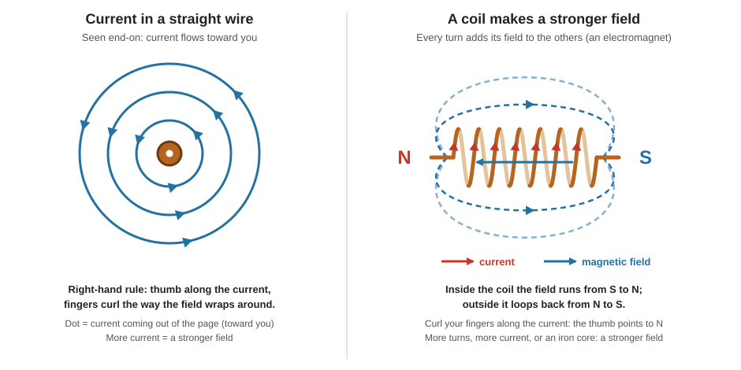

**Right-hand rule:** point your **thumb along the current** (the flow of positive charge, which is the opposite of electron flow). Your **curled fingers** show the direction the field wraps around the wire.

### 1.2 A coil strengthens the field

Wrap the wire into a coil and each turn adds its field to the others, forming **one large, more powerful field**. That is an **electromagnet**:

- **Outside** the coil the field runs from **north to south**.
- **Inside** the coil it runs from **south to north**.
- More turns and more current make the field stronger.

### 1.3 Why iron makes it much stronger (ferromagnetism)

Some metals, such as iron, are **ferromagnetic**. Their atoms behave like tiny magnets, but in ordinary iron the tiny magnets point in random directions, so they cancel out.

| What happens | Why |
|---|---|
| Put iron inside a coil | The coil's field makes the tiny magnets **line up** with it, which **adds** to the field. The iron becomes a magnet too. |
| Stronger field, more alignment | Think of the tiny magnets as stuck on springs: the stronger the field, the further they bend toward it. |
| **Saturation** | When they are all fully aligned, a stronger outside field makes no further difference. |
| Remove the field | The springs push back (unless they were bent permanently, which makes a permanent magnet). |
| Heat | Heat shakes the alignment loose, so **overheating ruins a permanent magnet**. |

---

## 2. The Key Rule: Lenz's Law ("The Stubborn Partner")

Magnetism acts like a stubborn partner: **anything produced by a change in magnetism opposes that change.** This is **Lenz's law**.

Here is what that means for a coil:

1. You try to **raise** the current → the field around the coil starts to **grow**.
2. The growing field acts back on the coil's own wire and **pushes against** the rising current.
3. That push is a voltage called the **back EMF** (EMF = electromotive force, simply a voltage-like push).

So the inductor **fights every change**: it resists a rise, and when the current falls it pushes to keep it going.

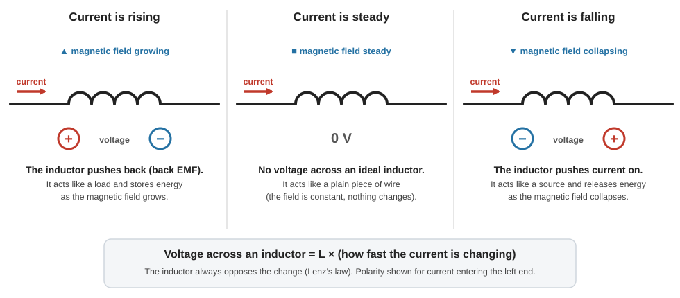

| Situation | What the inductor does | Acts like | Energy |
|---|---|---|---|
| Current **rising** | Pushes back (back EMF opposes the supply) | A **load** | Stores energy as the field **grows** |
| Current **steady** | Nothing to oppose | A plain **wire** | Field is constant |
| Current **falling** | Pushes current on (tries to keep it the same) | A **source** | Releases energy as the field **collapses** |

> **Inductor vs. capacitor (a handy contrast):** a **capacitor** resists changes in **voltage**; an **inductor** resists changes in **current**.

---

## 3. A Picture You Can Hold: The Water Wheel

Imagine water flowing through pipes:

- A **pump** pushes the water (the **battery**).
- The **pipes** are the **wires**.
- One branch has a **reducer** (a narrow section) that makes flow harder: that is **resistance** (a resistor, or a lamp).
- The other branch passes through a **heavy water wheel**: the **inductor**.

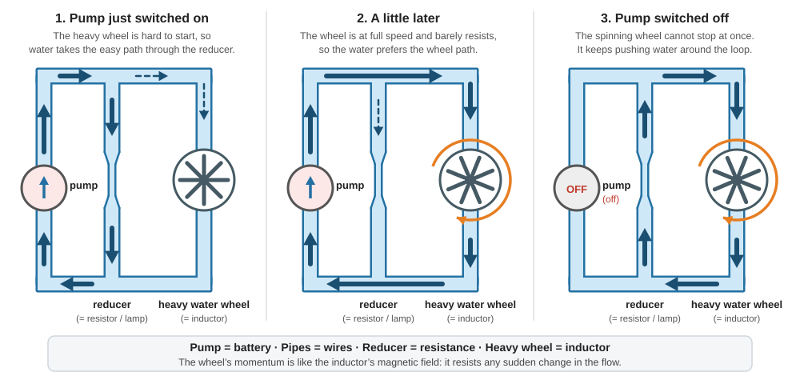

| Stage | What happens to the water | In the circuit |
|---|---|---|
| **1. Pump just switched on** | The heavy wheel is very hard to start, so it blocks the flow. Water takes the **reducer** path. | The inductor resists the rising current, so the current goes through the resistor/lamp. |
| **2. A little later** | The wheel is at full speed and barely resists. Water prefers the **wheel** path. | The inductor now acts like a plain wire and takes the current. |
| **3. Pump switched off** | The spinning wheel cannot stop at once. It **keeps pushing water around the loop** until friction slows it down. | The collapsing magnetic field keeps current flowing through the resistor/lamp. |

The wheel's **momentum** is like the inductor's **magnetic field**. Another picture from the same family is an **elastic hose**: push water in and the hose swells, so a steady flow comes out of the far end. If you suddenly shut off the input, the hose collapses and keeps pushing water out.

---

## 4. Seeing It in a Real Circuit

### 4.1 A lamp and an inductor side by side

Put a lamp **in parallel** with an inductor and connect a battery through a switch:

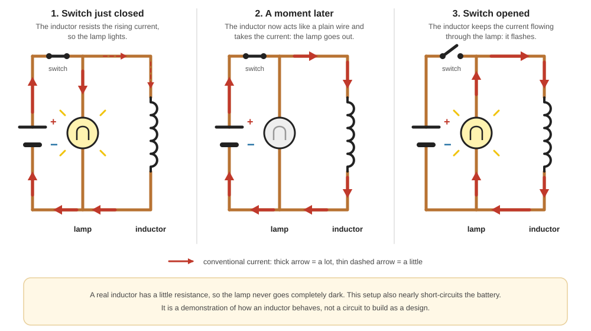

1. **Switch just closed:** the inductor resists the rising current, so almost nothing flows through it and the **lamp lights**.
2. **A moment later:** the magnetic field has built up and the inductor stops resisting. It becomes an easy path, the current takes it, and the **lamp goes out**.
3. **Switch opened:** the inductor sees the current drop and tries to keep it constant. The collapsing field pushes current **through the lamp**, which **flashes** and then fades as the energy is used up.

> A real inductor has a little resistance, so the lamp never goes completely dark. This setup also nearly short-circuits the battery. It is a demonstration, not a design to build.

### 4.2 What an oscilloscope would show

Connect a **resistor** and an **inductor** (each in its own circuit) to an oscilloscope:

| | Resistor | Inductor |
|---|---|---|
| **Current switched on** | Jumps **straight up** at once, then stays flat | **Curves up** gradually, then flattens |
| **Current switched off** | Drops **straight down** at once | **Curves down** gradually |

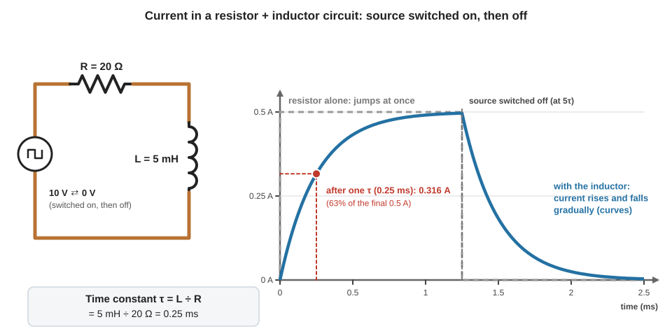

**Worked example** (the numbers used in the graph): a **10 V** source, a **20 Ω** resistor and a **5 mH** inductor in series.

| Quantity | Value | How |
|---|---|---|
| Final current | **0.5 A** | I = V ÷ R = 10 ÷ 20 (once the field has built up) |
| **Time constant (τ)** | **0.25 ms** | τ = L ÷ R = 5 mH ÷ 20 Ω |
| Current after 1 τ | **0.316 A** (63% of final) | 0.5 × (1 − e⁻¹) |
| Current after 5 τ (1.25 ms) | **0.497 A** (essentially final) | 0.5 × (1 − e⁻⁵) |

The **time constant τ = L ÷ R** tells you how quickly the current builds: **a bigger inductance or a smaller resistance makes it slower.** After about **5τ** the current has practically reached its final value. When the source is switched off, the current falls along the mirror-image curve.

---

## 5. The Inductive Kick: A Big Voltage From a Small Battery

An inductor's current cannot jump. The rule that links voltage and current is:

> **Voltage across an inductor = L × (how fast the current is changing)**

If the current changed in **zero** time, the voltage would have to be **infinite**, which is impossible. So the current is forced to change smoothly, and **if you try to cut it quickly, the inductor produces a large voltage to keep it flowing.**

### The "magic" LED trick

A **1.5 V** battery cannot light a white LED, which needs about **3 V**. Three LEDs in series need about **9 V**. With an inductor, it works anyway:

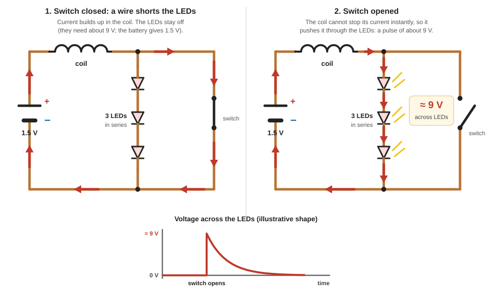

| Step | What happens |
|---|---|
| **1. Switch closed** (a wire shorts the LEDs) | The battery drives current through the coil, which builds up gradually (limited by the resistance of the coil and the battery). The magnetic field stores energy. The LEDs are bypassed. |
| **2. Switch opened** | The current cannot stop instantly. The collapsing field pushes it **through the LEDs**, and the voltage across them jumps to about **9 V** (enough to light all three). |
| **Result** | A brief pulse of light, then it fades as the stored energy runs out. |

The same effect can give you a small shock if the current is cut across your fingers, so **do not try this on yourself**.

**How big can the pulse be?** It depends on how fast the current is cut. For example, a **10 mH** coil carrying **0.1 A** that is cut to zero in **1 µs** would produce **L × ΔI ÷ Δt = 0.01 × 0.1 ÷ 0.000001 = 1,000 V** (an illustration of the formula; in practice other parts of the circuit limit it). This is why circuits with coils (relays and motors) often need protection against voltage spikes.

---

## 6. Inductors and AC

### 6.1 The current lags the voltage

With an AC (sine-wave) voltage, the current in an inductor is always **90° behind** the voltage (a quarter of a cycle).

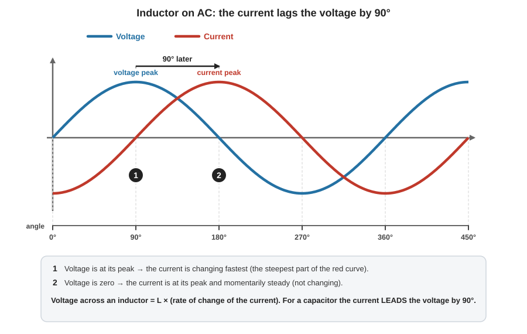

This follows directly from "voltage = L × rate of change of current":

- When the **current is changing fastest**, the **voltage is at its peak**.
- When the current is **momentarily steady** (at its own peak), the **voltage is zero**.

(For a **capacitor** it is the other way round: the current **leads** the voltage by 90°.)

### 6.2 "Inductor blocks AC": a saying that needs fixing

You may hear "a capacitor blocks DC and an inductor blocks AC". That is **inaccurate**. The correct version:

| | Capacitor | Inductor |
|---|---|---|
| **Steady DC** | **Blocks** it (open circuit) | **Passes** it (like a wire, a "short") |
| **Changing current (AC)** | Passes it more easily at higher frequency | **Opposes** it more strongly at higher frequency |

How strongly an inductor opposes AC is its **inductive reactance** (in ohms):

> **X_L = 2π × f × L**

For the 5 mH coil used in the examples:

| Frequency | Reactance X_L |
|---|---|
| 60 Hz (mains) | ≈ 1.9 Ω |
| 1 kHz | ≈ 31 Ω |
| 10 kHz | ≈ 314 Ω |
| 100 kHz | ≈ 3,142 Ω |

**The higher the frequency, the harder the inductor fights.** Compare these with the 20 Ω resistor: at 100 kHz the inductor completely dominates.

### 6.3 What this does to a square wave

Feed a **10 V on/off square wave** (50% on-time) through the **5 mH inductor** in series with **20 Ω**. Without the inductor the current would swing between 0 and 0.5 A. With it:

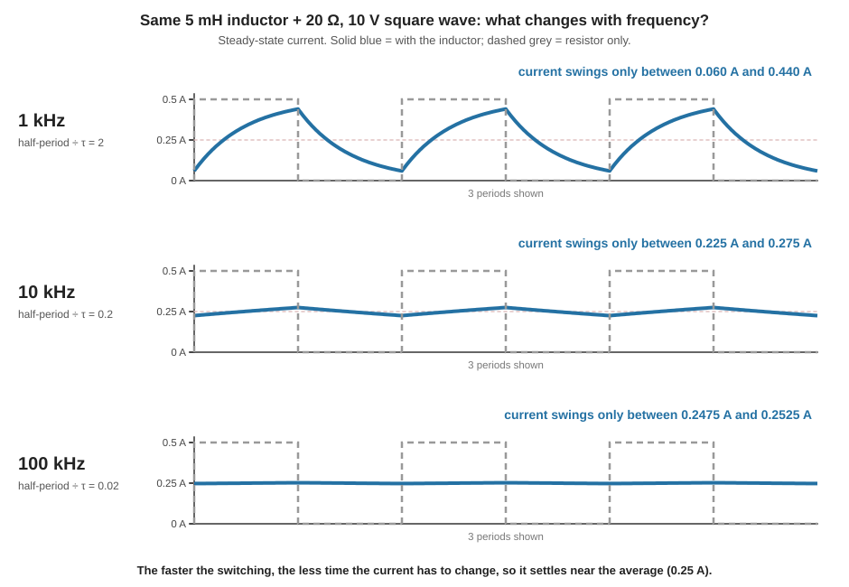

| Switching frequency | Half-period ÷ τ | Current swings between | What you see |
|---|---|---|---|
| **1 kHz** | 2 | 0.060 A and 0.440 A | Clear curves: the current visibly lags |
| **10 kHz** | 0.2 | 0.225 A and 0.275 A | Nearly flat, small wobble |
| **100 kHz** | 0.02 | 0.2475 A and 0.2525 A | Essentially flat at the **average, 0.25 A** |

At high frequency the inductor does not have time to store and release much energy before the input flips, so it **averages the current out**. This "averaging" is the basis of **low-pass filters** (section 10).

---

## 7. Energy Stored in the Magnetic Field

An inductor stores energy while current flows through it. The amount is:

> **Energy = ½ × L × I²**

| Example | Calculation | Energy |
|---|---|---|
| 5 mH carrying 0.5 A | ½ × 0.005 × 0.5² | **0.000625 J** (0.625 mJ) |
| 20 mH carrying 2 A | ½ × 0.02 × 2² | **0.04 J** |

Double the current and the stored energy goes up **four times**. This is the energy that is released as the field collapses (the lamp flash and the LED pulse above).

---

## 8. What Sets the Inductance (L)?

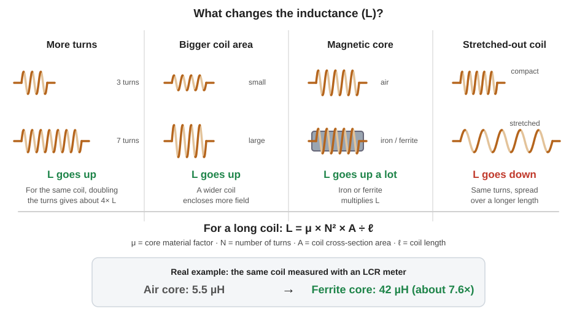

| Change | Effect on L | Why |
|---|---|---|
| **More turns** | **Up** (for a long coil, roughly with the *square* of the turns) | More wire loops, and each turn's field passes through all the others |
| **Larger coil (wider)** | **Up** | A longer length of wire and more area for the field |
| **Add a magnetic core (iron or ferrite)** | **Up a lot** | The core boosts the magnetic field, so more energy is stored for the same current |
| **Stretch the coil longer** (same turns) | **Down** | The turns are spread out, so their fields overlap less |

For a long coil the relationship is:

> **L = μ × N² × A ÷ ℓ**   (μ: core material factor, N: turns, A: area, ℓ: length)

**A real measurement:** an air-core coil measured **5.5 µH**. Putting a **ferrite core** in the middle raised it to **42 µH**, about **7.6 times** more, with no other change.

Instead of working this out by hand, you can use an **online coil inductance calculator**, or just buy inductors of a known value.

**Core saturation (an important limit):** a magnetic core can only hold so much field. If the current gets too high, the core **saturates** and the inductance drops. Real inductors therefore have a **maximum current rating**.

### 8.1 Units and typical sizes

Inductance is measured in **henrys (H)**. The bigger the number, the more energy it can store and the more strongly it resists change.

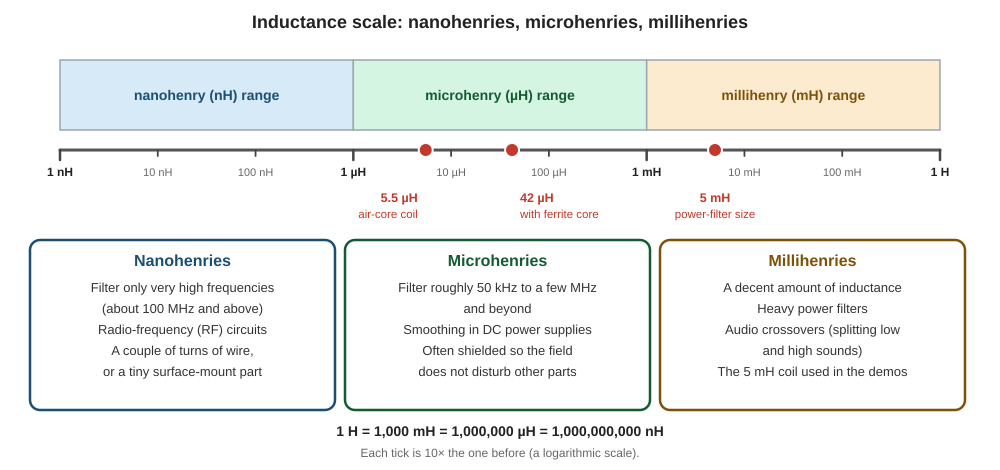

| Range | Typical use | Notes |
|---|---|---|
| **Nanohenries (nH)** | Radio-frequency (RF) circuits. They only filter very high frequencies (about **100 MHz and above**). | Can be just a couple of turns of wire held with glue, or a tiny surface-mount part |
| **Microhenries (µH)** | **DC power supplies** (smoothing). They filter roughly **50 kHz up to a few MHz and beyond**. | Often **shielded** so the magnetic field does not disturb nearby parts |
| **Millihenries (mH)** | **Heavy power filters** and **audio crossovers** (separating low and high sounds) | A decent amount of inductance |

**Conversions:** 1 H = 1,000 mH = 1,000,000 µH = 1,000,000,000 nH.

### 8.2 How to measure inductance

| Tool | Result |
|---|---|
| **LCR (or RLC) meter** | Accurate. Connect the inductor and it runs a quick test. Good ones are expensive. |
| **Standard multimeter** | Cannot measure inductance. A few models have the function built in, but it is not very accurate (fine if you do not need precision). |

---

## 9. What Inductors Look Like

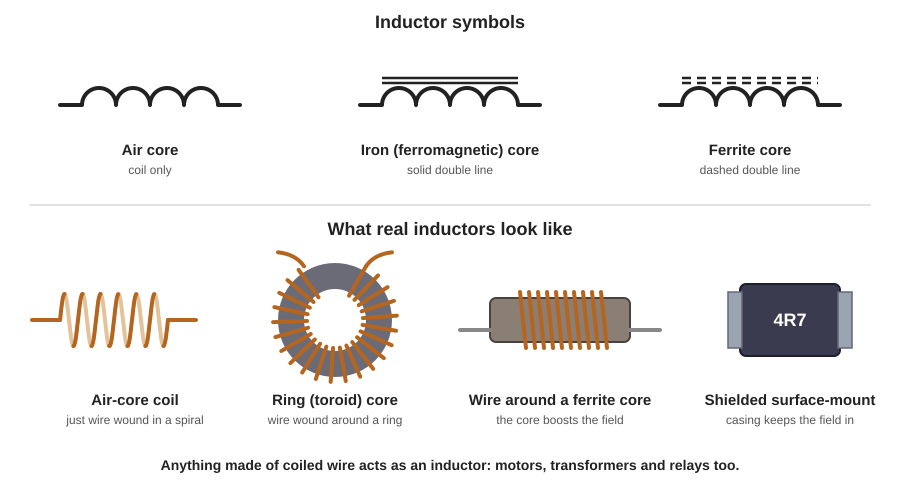

| Type | Description |
|---|---|
| **Air-core coil** | Just wire wound in a spiral |
| **Ring (toroid) core** | Wire wound around a ring-shaped core |
| **Wound ferrite or iron core** | A core boosts the field and the inductance |
| **Shielded surface-mount** | A casing keeps the magnetic field in so it does not interfere with other parts |

**Symbols:** a row of loops (humps). A **solid double line** above it means an **iron core**; a **dashed double line** means a **ferrite core**.

> **Anything built from coiled wire acts as an inductor**, including **motors, transformers and relays**. Every wire also has a tiny amount of inductance, which is why coiling it up makes the effect bigger.

---

## 10. Combining Inductors

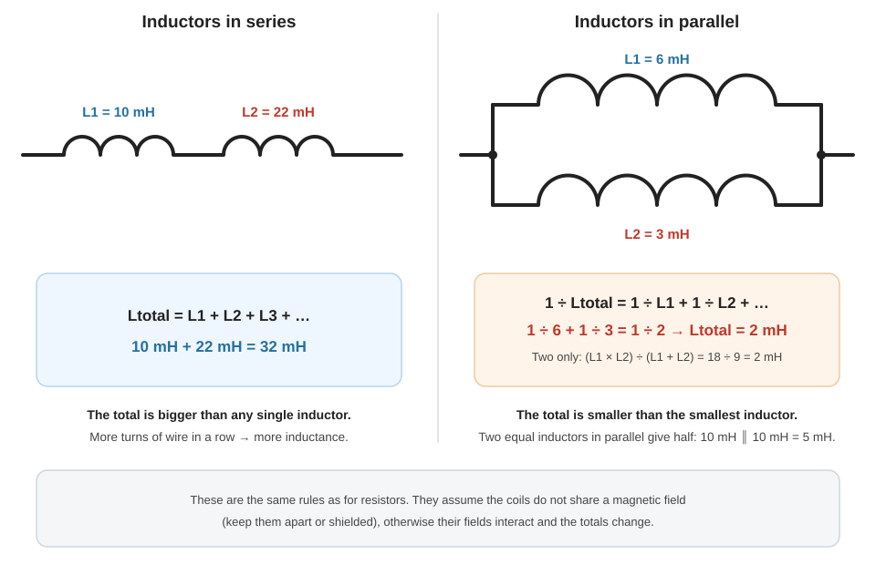

| Arrangement | Rule | Example |
|---|---|---|
| **Series** | Add them: **L_total = L1 + L2 + …** (it is like putting more turns of wire in a row) | 10 mH + 22 mH = **32 mH** |
| **Parallel** | **1 ÷ L_total = 1 ÷ L1 + 1 ÷ L2 + …** (the total is smaller than the smallest) | 6 mH ∥ 3 mH = **2 mH** |
| Parallel, two equal | Half of one | 10 mH ∥ 10 mH = **5 mH** |

These are **exactly the same rules as for resistors** (see [Series & Parallel Circuits](https://github.com/MK-726/Electronics/tree/main/Notes/Series-vs-Parallel-Circuit)). They assume the coils do not share a magnetic field, so keep them apart or shielded.

---

## 11. What Are Inductors Used For?

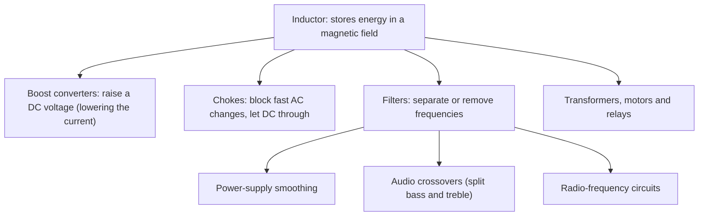

### 11.1 Example: smoothing with an LC filter

Add a **capacitor** after the inductor and you get a very clean DC output from a square wave. The coil resists fast changes in current and the capacitor soaks up what is left of the ripple. Together they form an **LC low-pass filter**, which is how good power supplies smooth their output voltage.

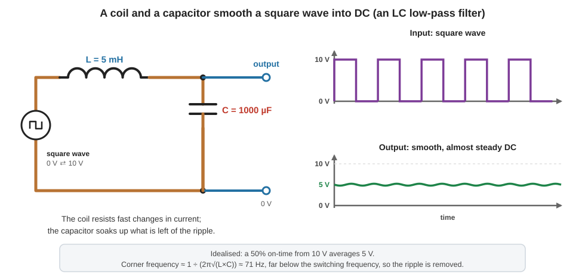

For this example (5 mH and 1000 µF), the corner frequency is about **1 ÷ (2π√(L × C)) ≈ 71 Hz**. A switching frequency in the kilohertz range is far above that, so the ripple is removed and the output settles near the **average (5 V, for a 50% on-time from 10 V)**. This is an idealised case with no load.

---

## 12. The "Magic" Demos, Explained

All of these are just **changing magnetic fields and Lenz's law**:

| Demo | What happens | Why |
|---|---|---|
| **LEDs lit by a 1.5 V battery** | Pulses of about 9 V light three LEDs | The coil's collapsing field forces current through them (section 5) |
| **A shock from the same pulses** | You feel it across your fingers | The same high-voltage pulse. **Do not try it.** |
| **Magnet dropped through aluminium foil or an aluminium frame falls slowly** | The magnet drifts down instead of dropping | The moving magnet induces currents in the aluminium, and those currents' fields **oppose the motion** |
| **A few turns of wire and an LED lit on a wireless charger** | The LED glows | The charger's **changing** magnetic field induces a current in the coil |
| **Two reversed LEDs across a coil, a magnet passed through** | One LED lights going in, the other coming out | The induced current **reverses** when the magnet starts leaving (below) |

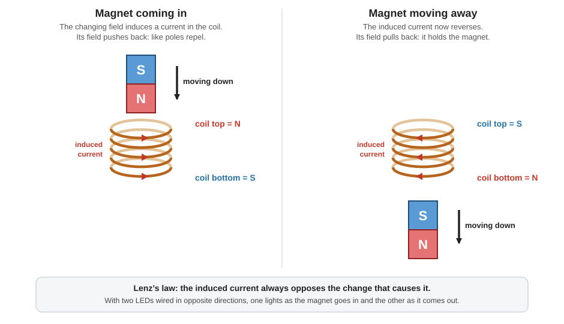

| Moment | Induced coil face (toward the magnet) | Effect |
|---|---|---|
| Magnet **approaching** | Same pole as the magnet (N faces N) | **Repels**: pushes back |
| Magnet **leaving** | Opposite pole to the magnet | **Attracts**: pulls back |

---

## 13. Inductor vs. Capacitor

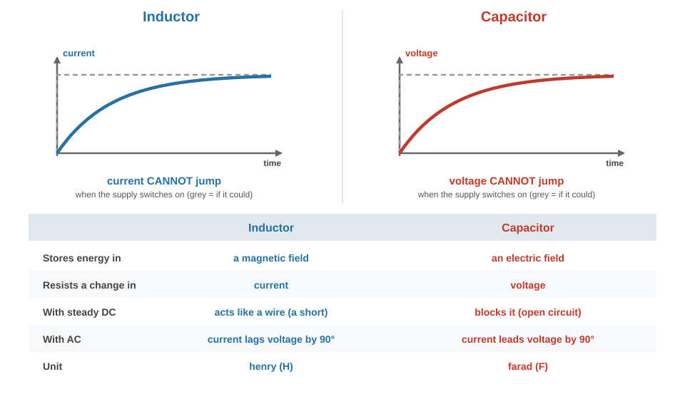

---

## 14. Common Misunderstandings

| Misunderstanding | What is actually true |
|---|---|
| "An inductor blocks AC." | It **opposes changes** in current more strongly as the frequency rises. It lets steady DC through. |
| "An inductor stores charge." | It stores **energy in a magnetic field**. (A capacitor stores energy in an electric field.) |
| "An inductor has no effect on DC." | It has almost none for **steady** DC (just the small resistance of its wire), but it **does** resist the moment the DC is switched on or off. |
| "The current in an inductor can jump." | It **cannot change instantly**: that would need an infinite voltage. |
| "An inductor releases its energy instantly." | Very quickly, but not instantly. The field collapses over a short time. |
| "Inductors are just parts on a circuit board." | **Motors, transformers and relays** are coils and behave as inductors too. |
| "Putting an inductor in a circuit always lowers the current." | It only resists **changes**. The final steady current (with DC) is set by the resistance, as before. |

---

## 15. Test Yourself

| # | Question | Answer |
|---|---|---|
| 1 | What is the time constant of a 5 mH inductor with a 20 Ω resistor? | τ = L ÷ R = **0.25 ms** |
| 2 | In that circuit with a 10 V source, what current flows after 1 τ? | About **0.316 A** (63% of 0.5 A) |
| 3 | About how long until the current is essentially at its final value? | About 5 τ = **1.25 ms** |
| 4 | What is 10 mH in series with 22 mH? | **32 mH** |
| 5 | What is 6 mH in parallel with 3 mH? | **2 mH** |
| 6 | What is 4 mH in parallel with 12 mH? | (4 × 12) ÷ (4 + 12) = **3 mH** |
| 7 | What is the reactance of 10 mH at 1 kHz? | X_L = 2π × 1000 × 0.01 ≈ **62.8 Ω** |
| 8 | How much energy does a 20 mH inductor store at 2 A? | ½ × 0.02 × 2² = **0.04 J** |
| 9 | What voltage appears across 50 mH if the current rises from 0 to 2 A in 10 ms? | L × ΔI ÷ Δt = 0.05 × 2 ÷ 0.01 = **10 V** |
| 10 | An air-core coil is 5.5 µH. With a ferrite core it is 42 µH. By what factor did it increase? | 42 ÷ 5.5 ≈ **7.6×** |
| 11 | When the current in an inductor is falling, does it act like a load or a source? | A **source**: it releases stored energy |
| 12 | Does a capacitor or an inductor "short" steady DC? | The **inductor** (a capacitor blocks it) |

---

## 16. Glossary

| Term | Plain-English meaning |
|---|---|
| **Inductor** | A coil of wire that stores energy in a magnetic field |
| **Inductance (L)** | How strongly an inductor resists a change in current; measured in henrys (H) |
| **Henry (H)** | The unit of inductance (mH = thousandths, µH = millionths, nH = billionths) |
| **Magnetic field** | The invisible region of force around a current or a magnet |
| **Lenz's law** | A change in magnetism produces effects that oppose that change |
| **EMF / back EMF** | A voltage-like push; the back EMF is the push that opposes the current that caused it |
| **Core** | The material (air, iron, ferrite) inside the coil |
| **Ferromagnetic** | A material (like iron) whose tiny magnets line up with a field and strengthen it |
| **Saturation** | When a core cannot hold any more field and inductance drops |
| **Time constant (τ)** | L ÷ R: how fast current builds in a coil with a resistor |
| **Inductive reactance (X_L)** | How strongly an inductor opposes AC at a given frequency: 2π × f × L |
| **Choke** | An inductor used to block fast changes (high frequencies) |
| **LC filter** | An inductor and a capacitor together, used to smooth or filter |
| **LCR meter** | An instrument that measures inductance, capacitance and resistance |

---

## Quick Recap

- **Current makes a magnetic field; a coil strengthens it; an iron or ferrite core strengthens it further.**
- **Lenz's law:** a change in the field pushes back against the change that caused it. An inductor therefore **resists changes in current**, and its current **cannot change instantly**.
- **Rising current:** the inductor acts like a load and stores energy. **Steady current:** it acts like a wire. **Falling current:** it acts like a source and releases energy.
- **Voltage = L × (rate of change of current).** Cutting the current quickly makes a large voltage pulse (the inductive kick).
- **Time constant τ = L ÷ R.** The current reaches about 63% after 1τ and is essentially done after 5τ.
- On **AC**, the current **lags the voltage by 90°**, and the opposition (**X_L = 2πfL**) grows with frequency. It does not "block AC"; it **shorts steady DC**.
- **Energy = ½LI².** More turns, a bigger coil or a magnetic core raises L; a stretched-out coil lowers it.
- **Series:** add them. **Parallel:** like resistors. Sizes run from **nH (radio)** through **µH (power supplies)** to **mH (heavy filters, audio crossovers)**.
- Use an **LCR meter** to measure inductance. A standard multimeter cannot.

---

## Sources

### The videos this guide is built from

| Source | Used for |
|---|---|
| [ElectroBOOM: Inductors (101 series)](https://youtu.be/ySx84Ca7BFQ?si=dSkbB8nU8-wzrWma) | The LED and shock demos, magnetism basics (fields, ferromagnetism, saturation), Lenz's law, the elastic-hose picture, "inductor shorts DC", V = L × rate of change, the 90° lag, why the LED trick works |
| [The Engineering Mindset: Inductors Explained](https://youtu.be/KSylo01n5FY?si=X3AReD-39uepEAz_) | The water-wheel analogy, lamp and inductor in parallel, back EMF, oscilloscope curves, appearance and symbols, uses (boost converters, chokes, filters), measuring with an RLC meter |
| [Afrotechmods: Inductors, part 1 (introduction)](https://youtu.be/NgwXkUt3XxQ?si=Ipnrz6R5MymBj6Sa) | Stores energy in a magnetic field, "current cannot instantly change", the 10 V / 20 Ω / 5 mH square-wave demo at 1, 10 and 100 kHz, averaging and LC filters, almost no effect on DC |
| [Afrotechmods: Inductors, part 2 (inductance values)](https://youtu.be/VSMGnmQApA0?si=7HfUTqNkJorfC8g5) | The henry, nH / µH / mH ranges and uses, number of turns and cores, the 5.5 µH to 42 µH ferrite example, series and parallel rules |

### Further reading

| Source | What it adds |
|---|---|
| [MIT OpenCourseWare 8.02: Inductance summary (PDF)](https://ocw.mit.edu/courses/8-02t-electricity-and-magnetism-spring-2005/64145d9d3bb94fe6b93b0301fefb143b_summary_w10d2.pdf) | Self-inductance, back EMF, energy stored in an inductor, LR circuits |
| [Georgia Tech Physics 2212, Lab 12: Inductance and RL circuits](https://www.introphys.gatech.edu/lab/2212/lab12/prelab.html) | The time constant τ = L ÷ R, the rising-current curve, inductive reactance |
| [All About Circuits: Inductors](https://www.allaboutcircuits.com/textbook/product/inductors/) | Textbook-style introduction to inductors and inductance |
| [RedCrab: Inductor calculators](https://www.redcrab-software.com/en/Calculator/Electrics/Inductors) | Formulas and calculators for reactance, energy and RL values |
| [Inductance calculator (solenoid coil)](https://www.calculate.co.nz/inductance-calculator.php) | Try the coil formula with your own turns, area and length |

### Notes on accuracy

| Topic | How this guide handles it |
|---|---|
| **"A capacitor blocks DC, an inductor blocks AC"** | One video calls this inaccurate. The guide says an inductor **shorts steady DC** and **opposes changes** more strongly at higher frequency. |
| **Formulas not stated in the videos** | The time constant, the reactance, the stored energy and the coil formula are standard results (see the further reading). The ripple values in the frequency table were calculated from the RL equations for the demo's 10 V, 20 Ω and 5 mH. |
| **The lamp-and-inductor demo** | Shown as a demonstration only: a real inductor has resistance, and the arrangement nearly short-circuits the battery. |
| **The 1,000 V example** | A simple L × ΔI ÷ Δt illustration, not a prediction for a real circuit. |
| **Magnet and coil directions** | Worked out with Lenz's law and the right-hand rule. Which LED lights depends on how the LEDs are wired. |
| **Diagrams** | The curves in the current, square-wave and phase figures are plotted from the equations. The voltage pulse in the LED demo is an illustrative shape. |
