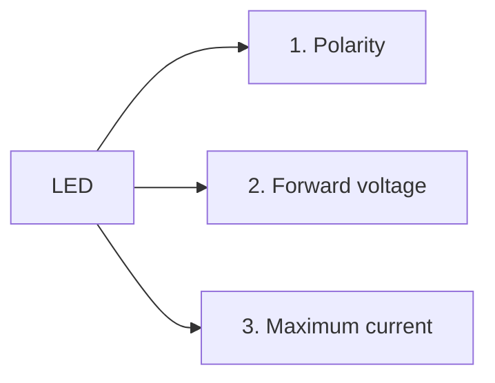
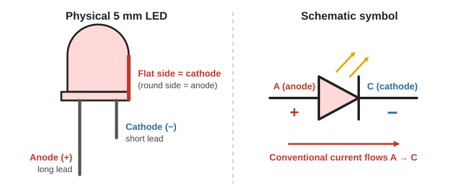
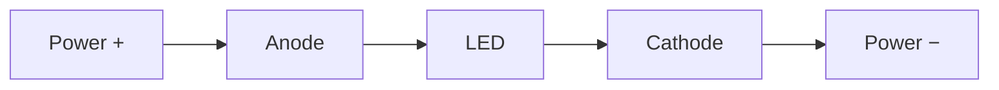
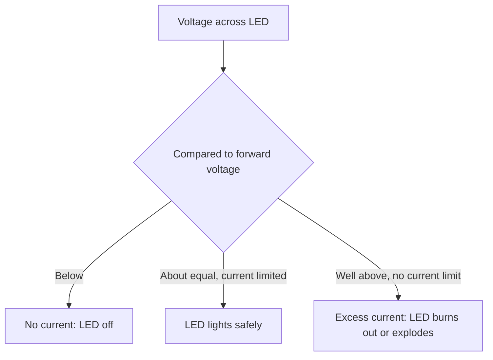

# LED Basics

> **In one line:** An LED (light emitting diode) is an efficient light source that needs the **right polarity**, enough **forward voltage**, and a **current limit** to work safely.

---

## 1. Why LEDs?

| | Incandescent bulb | LED |
|---|---|---|
| **How it makes light** | Heats a thin wire (filament) until it glows | Electroluminescence in two joined semiconductors |
| **Efficiency** | Under 5% of energy becomes light, the rest is heat | Much more efficient, less heat |
| **Size** | Large | Very small for the light produced |
| **Lifespan** | Short | Over 10 years of continuous use (average) |

---

## 2. The Three Things to Know About Every LED

---

## 3. Polarity (Which Way Round?)

An LED has two leads:

| Lead | Short name | Connect to | Current |
|---|---|---|---|
| **Anode** | A | **Positive (+)** of the power source | Conventional current flows **in** |
| **Cathode** | C | **Negative (−)** of the power source | Conventional current flows **out** |

**How to identify the leads on a standard 5 mm LED:**

| Clue | Anode (+) | Cathode (−) |
|---|---|---|
| **Lead length** | Longer | Shorter |
| **Case shape** | Round side | **Flat** side |

**Connected backwards?** In low-voltage projects, a backwards LED simply blocks current and does not light. It does no harm.

---

## 4. Forward Voltage

An LED needs a **minimum voltage across it, in the correct direction**, before any current flows and it emits light.

Example: a white LED with a **forward voltage of about 3 V**:

| Supply voltage | Result |
|---|---|
| 0 V | Off |
| 1.5 V | Still off (not enough) |
| Approaches 3 V | Turns on, reaching full brightness |

- Every LED type has a slightly different forward voltage.
- Once the LED is on, the voltage across it stays **fairly constant** (a "voltage drop").

---

## 5. Maximum Current

Forward voltage alone is **not** enough to run an LED safely. If the voltage is well above the forward voltage, **a huge current flows and the LED destroys itself**.

| LED type | Typical maximum current |
|---|---|
| Standard 5 mm LED | about **20 mA** |
| High-power LED module (example) | about **100 mA** |

*(1 mA = 0.001 A)*

> ⚠️ **Safety:** An LED with no current limit can **explode**, throwing small pieces of plastic and metal. Never connect an LED directly to a power source that is much higher than its forward voltage (for example, a 9 V battery will instantly kill a standard LED). Wear eye protection when experimenting.

**How to limit current:**
- A **current-limited power supply** (adjustable lab supply), or
- A **resistor** in series with the LED: cheap (a few pennies) and the standard solution. *(Covered in the next topic: Resistance.)*

---

## Quick Recap

- LEDs are far more efficient than filament bulbs.
- **Anode (+)**: long lead, round side. **Cathode (−)**: short lead, flat side.
- Needs its **forward voltage** (about 3 V for white) before it lights.
- **Always limit current** (about 20 mA for a standard 5 mm LED), or it will burn out or explode.
- Use a **resistor** to limit current when you don't have a current-limited supply.

---

**Source:** [Basic Electricity series, Part 3: LEDs (Afrotechmods)](https://youtu.be/Yo6JI_bzUzo?si=hRAUIZBNamrXO8SD)