# Resistors

> **In one line:** A resistor **limits the flow of current** by turning some electrical energy into heat. Resistors come in many types: fixed, variable, and automatic. Each has a **resistance**, a **tolerance**, and a **power rating** you must respect, or the resistor can burn out.

> ⚠️ **Heat warning:** Resistors that dissipate more power than their rating **overheat and can catch fire**. Always check the power before you build (see [section 8](#8-resistors-in-action)).

*Related guides: [Resistance & Ohm's Law](https://github.com/MK-726/Electronics/tree/main/Notes/Basic-Electricity/Resistance-and-Ohms-law-guide) · [Electrical Power & Watts](power-watts.md) · [LED Basics](led-basics.md) · [Series & Parallel Circuits](series-parallel-circuits.md)*

---

## 1. What Does a Resistor Do?

**Example:** connect an LED straight to a 9 V battery and it is destroyed instantly. The battery tries to push so many electrons through the thin wire inside the LED that the wire breaks.

A **resistor** protects it by **reducing the current**. It does this by **removing energy from the circuit**, literally **turning electrical energy into heat**.

| Term | Meaning |
|---|---|
| **Resistance** | How much a material opposes the flow of electrons. Measured in **ohms (Ω)**. |
| **Resistor** | A component that adds resistance to a circuit |
| **Voltage drop** | The voltage "lost" across the resistor |

**Traffic jam, not speed bump.** A resistor does not just slow each electron down for a moment. It acts like a **traffic jam**, restricting **how many electrons can flow**.

**Water pipe analogy**

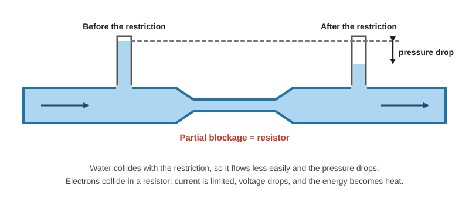

| Pipe | Resistor |
|---|---|
| Water flows easily through a clear pipe | Electrons flow easily through a wire |
| A partial blockage makes water collide and flow less easily | A resistor makes electrons collide, so current is **limited** |
| **Pressure drop** across the restriction | **Voltage drop** across the resistor |
| Collisions lose energy | Collisions turn kinetic energy into **heat** (why resistors get hot) |

---

## 2. Symbols and Types

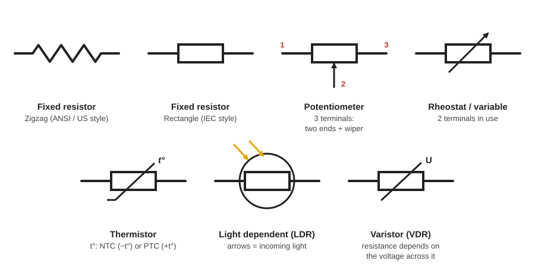

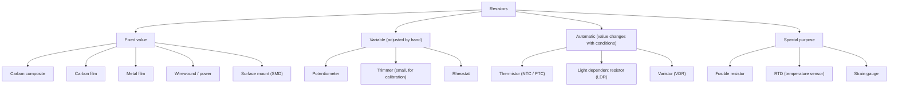

---

## 3. Ratings: Never Exceed Them

Every resistor has rated limits. The important ones:

| Rating | Meaning |
|---|---|
| **Resistance (value)** | In ohms. Fixed types are marked with colour bands or a number. Variable types show the **maximum** resistance. |
| **Tolerance** | How far the real value can differ from the stated value (for example ±5%) |
| **Power** | The most heat it can dissipate (for example 0.5 W) |
| **Voltage** | The maximum voltage it can handle |

**Why power matters:** a resistor generates heat. If it cannot dissipate enough, its temperature rises until the **protective layer catches fire** and the resistor is destroyed.

**Size = power rating:** a larger resistor has more surface area, so it can shed more heat and has a **higher power rating**.

---

## 4. Fixed Resistors

### 4.1 Through-hole types (carbon composite, carbon film, metal film)

These plug into prototype boards or solder into printed circuit boards. They are cheap in bulk, which makes them ideal for learning and for making mistakes.

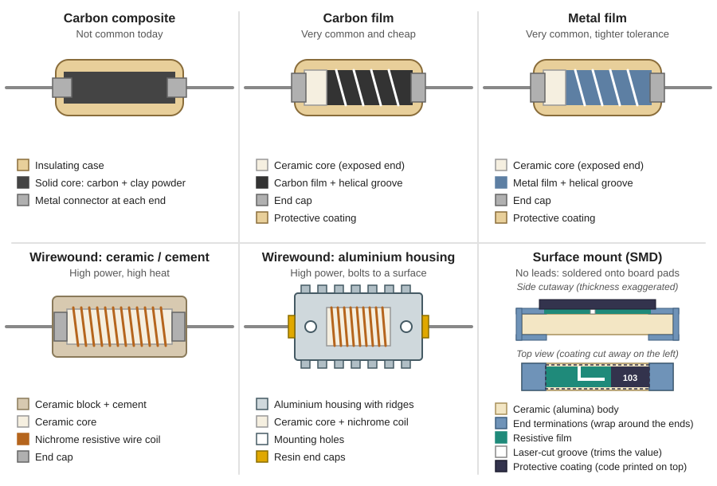

| Type | How it is made | Notes |
|---|---|---|
| **Carbon composite** | Carbon or graphite mixed with an insulating powder (such as clay) forms a **solid core**, with a metal connector at each end, inside an insulating case. Electrons flow through the core. | **Not common today.** Modern types have better performance and stability and last much longer. |
| **Carbon film** | A **ceramic core** coated with a thin **carbon layer**, with end caps, in an insulating case. A **helical groove** is cut into the carbon to set the resistance. | **Very common and very cheap.** Usually **4 colour bands**. |
| **Metal film** | A **ceramic core** coated with a thin **metal layer**, with end caps and a protective coating. A **helical groove** sets the resistance. | **Very common.** **Tight tolerance** (accurate) and **very good stability**, so often preferred. Slightly more expensive. Usually **5 colour bands**. |

**How the groove sets the resistance (film resistors)**

Cutting a helical groove forces the electrons along a **longer, narrower path**, so more collisions occur and the resistance **increases**.

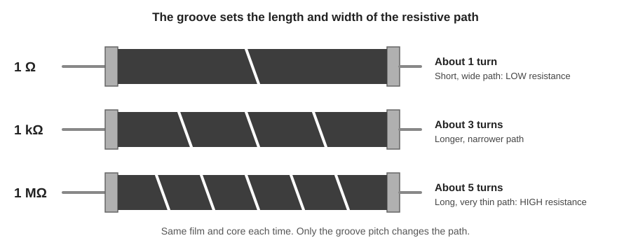

| Resistor | Groove | Path | Resistance |
|---|---|---|---|
| 1 Ω | Short (few turns) | Wide | Low |
| 1 kΩ | About 3 turns | Narrower | Medium |
| 1 MΩ | About 5 turns | Very thin and long | High |

### 4.2 Wirewound and power resistors

For **high power and high heat**. The value and power rating are **printed on the body** (for example "50 W, 2 Ω").

| Type | Construction | Example rating |
|---|---|---|
| **Ceramic / cement** | A **nichrome wire coil** wrapped around a **ceramic core** with two end caps, buried in a ceramic block with cement. The cement and ceramic **protect the wire** in high-heat use. | 10 W, 10 Ω |
| **Aluminium housing** | A ceramic core with a nichrome coil between two connectors, insulated, inside a **metal housing with ridges** (more surface area to shed heat) and resin end caps. **Holes in the casing** let you mount it to a surface. | 10 W, 33 Ω |

### 4.3 Surface-mount (SMD) resistors

Used in **compact circuit boards**, soldered directly onto metal pads with a soldering iron or solder paste. Some are so small they need a **specialist machine** (or a microscope to see).

- Construction: a **ceramic body** with an **electrode on each end**, joined by a thin **resistive layer** covered by an **insulating protective coat**.
- A **laser-cut groove** in the resistive layer reduces the area electrons can flow through, so the resistance increases.
- **Tight tolerance** (accurate), but a **very low power rating**.

---

## 5. Reading Resistor Values

### 5.1 Colour bands (through-hole resistors)

You can also read the value from the packaging or measure it with a multimeter. Otherwise use the chart.

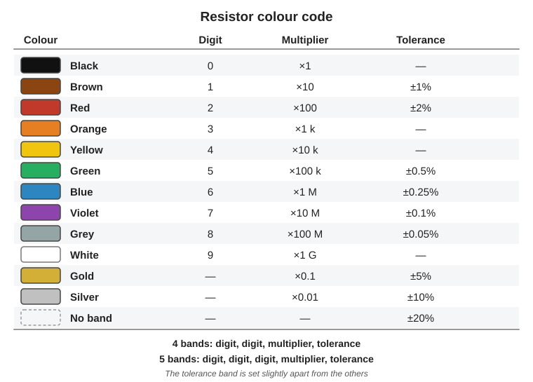

| Resistor | Bands (in order) |
|---|---|
| **4-band** (usually carbon film) | digit, digit, **multiplier**, **tolerance** |
| **5-band** (usually metal film) | digit, digit, digit, **multiplier**, **tolerance** |

The **tolerance band is separated** from the other stripes.

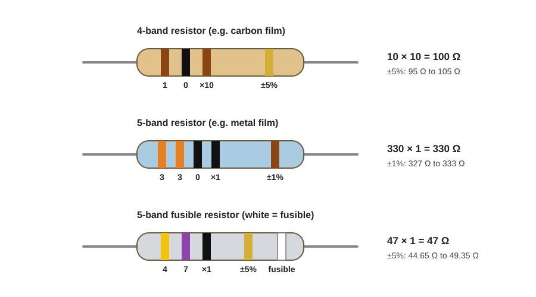

| Example | Reading | Value | Tolerance range |
|---|---|---|---|
| **Brown, black, brown, gold** (4-band) | 1, 0, ×10, ±5% | 10 × 10 = **100 Ω** | 95 Ω to 105 Ω |
| **Orange, orange, black, black, brown** (5-band) | 3, 3, 0, ×1, ±1% | 330 × 1 = **330 Ω** | 327 Ω to 333 Ω |
| **Yellow, violet, black, gold, white** (fusible) | 4, 7, ×1, ±5%, fusible | 47 × 1 = **47 Ω** | 44.65 Ω to 49.35 Ω |

**Check with a multimeter:** measured values land inside the tolerance range.

| Resistor | Rated | Measured | Within range? |
|---|---|---|---|
| Brown, black, brown, gold | 100 Ω ±5% (95 to 105 Ω) | 98.2 Ω | Yes |
| Orange, orange, black, black, brown | 330 Ω ±1% (327 to 333 Ω) | 329.99 Ω | Yes |

### 5.2 SMD codes

SMD resistors print a **number code** on top.

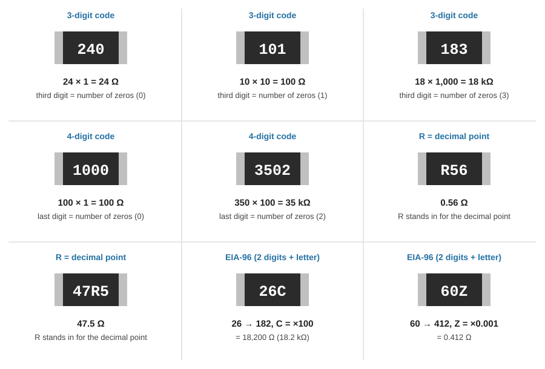

| Code type | Rule | Example |
|---|---|---|
| **3-digit** | First two digits = value, **third = number of zeros** | 240 → 24 Ω · 101 → 100 Ω · 183 → 18 kΩ |
| **4-digit** | First three digits = value, **fourth = number of zeros** | 1000 → 100 Ω · 3502 → 35 kΩ |
| **R in the code** | **R is the decimal point** | R56 → 0.56 Ω · 47R5 → 47.5 Ω |
| **EIA-96** (3 characters, letter at the end) | Look up the **two digits** in the EIA-96 table to get a 3-digit value, then apply the **letter multiplier** | 26C → 26 = 182, C = ×100 → 18,200 Ω · 60Z → 60 = 412, Z = ×0.001 → 0.412 Ω |

**EIA-96 letter multipliers** (from the standard chart):

| Letter | Z | Y or R | X or S | A | B or H | C | D | E | F |
|---|---|---|---|---|---|---|---|---|---|
| **Multiplier** | ×0.001 | ×0.01 | ×0.1 | ×1 | ×10 | ×100 | ×1,000 | ×10,000 | ×100,000 |

---

## 6. Variable Resistors

### 6.1 Potentiometers

A **potentiometer** has a dial that changes the resistance. **General-use** versions are used for things like volume controls; **precision** versions are used to tune electronic circuits. Very small ones, called **trimmers**, are used to calibrate circuits.

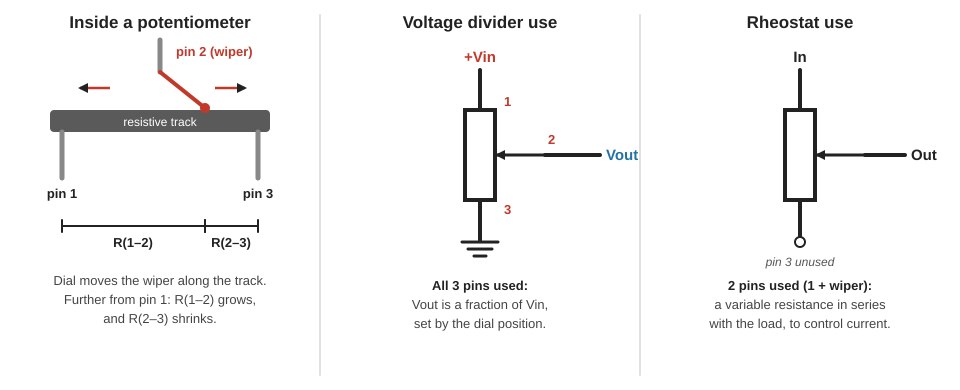

**Three terminals:** a **resistive track** runs between the two **end pins**, and the dial moves a **wiper** that connects the track to the **centre pin**. Moving the dial increases the distance electrons must travel, so the resistance **increases**.

| Use | Pins used | What it does |
|---|---|---|
| **Voltage divider** | **All three.** Voltage across the two end pins; take the output from the centre pin. | Gives **part of the voltage drop**, so you control the **output voltage** |
| **Rheostat (variable resistor)** | **Centre pin + one end pin** | Controls the **current** in the circuit |

### 6.2 Reading potentiometer markings

| Marking | Meaning |
|---|---|
| **1K** | 1,000 Ω maximum |
| **500K** | 500,000 Ω maximum |
| **Letter (for example B)** | The type. **B = linear** (resistance changes in a straight-line way). Logarithmic types also exist. |
| **3-digit code on small types** | First two digits + number of zeros: **101** = 100 Ω, **204** = 200,000 Ω |

### 6.3 Rheostats

A **rheostat** controls **large currents** (hence its size) and is connected **in series with the load**. It uses only **two terminals at a time**, even if three or four are available. Low-current circuits can use a potentiometer as a rheostat.

- **Construction:** resistive wire coiled around an insulating **ceramic core** (arc-shaped or cylindrical).
- **Operation:** the further the sliding arm moves along the wire, the further electrons must travel, so the resistance **increases**.
- **Contact:** a raised surface on the sliding arm, or a **replaceable carbon brush** with a flexible connection to the centre terminal.
- **Markings:** maximum resistance, maximum current, or maximum power.

---

## 7. Automatic and Special-Purpose Resistors

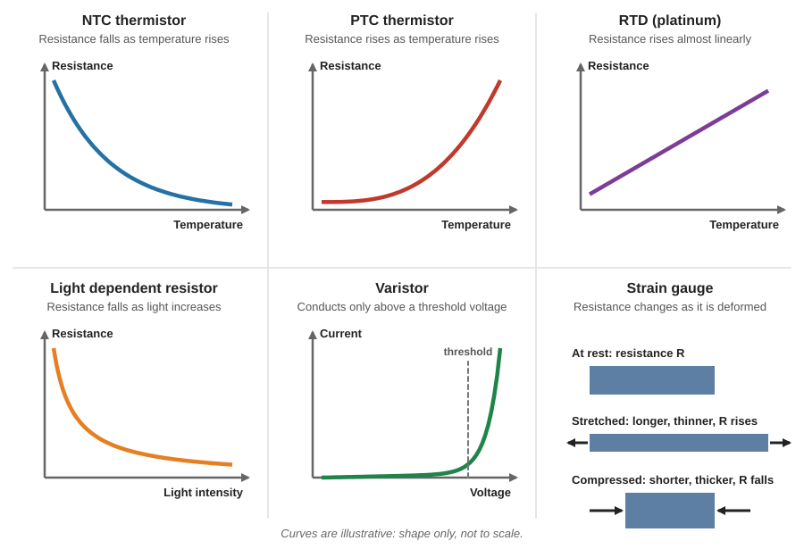

| Type | What it does | How it works | Used for |
|---|---|---|---|
| **Fusible resistor** | Acts as a **fuse and a resistor**. When overloaded it **breaks the circuit without bursting into flames** (a standard resistor would burn). | Ceramic core with a resistive wire between end caps, in a **fire-resistant resin**. The wire heats up and **snaps** at a set temperature. Some use a thin metal alloy layer with a groove instead. **Last band is white.** | Protecting circuits |
| **Varistor (VDR)** | Resistance depends on **voltage** | Normally **very high resistance** (acts as an insulator). Above a certain voltage it **becomes a conductor and shorts to ground**. Zinc metal oxide grains with a ceramic core, metal plates, epoxy coating. Connected **in parallel** across the supply. | Protecting circuits from **voltage spikes** |
| **Thermistor** | Resistance depends on **temperature** | A semiconductor layer between two conductors. Heat gives electrons enough energy to break free. **NTC:** resistance **falls** as temperature rises. **PTC:** resistance **rises** as temperature rises. | Inrush current limiting, temperature sensing and control (glass types for high temperature) |
| **RTD** | Temperature sensor | A **platinum wire** wrapped around a ceramic core. Hotter atoms vibrate more, causing more collisions, so resistance **rises** in a near-linear way, which makes calculations easy. Often fitted in a metal case. | Measuring temperature (for example of liquids) |
| **LDR** (light dependent resistor) | Resistance depends on **light** | Ceramic base coated with **cadmium sulfide** and two electrodes with a small gap. In the dark, resistance is **high**. Light (photons) knocks electrons loose, so resistance **falls** as light increases. | Automatic night lights, dark-sensor circuits |
| **Strain gauge** | Resistance changes when **deformed** | A thin **foil grid** on insulation. **Stretched:** longer and thinner, resistance **rises**. **Compressed:** shorter and thicker, resistance **falls**. | Measuring pressure, often in **Wheatstone bridge** circuits (for example an electronic pressure switch) |

**Reading markings**

- **Varistor example, 14D121K:** 14 = diameter, D = shape, **121** = 12 followed by one zero = **120 V**, K = **±10%** (so 108 V to 132 V).
- **LDRs** usually have **no markings**. Check the packaging, or identify one by testing in **complete darkness**.
- **Fusible resistor bands:** the white fifth band marks it as fusible. The other four bands give the resistance.

---

## 8. Resistors in Action

### 8.1 Always check the power rating

A 9 V battery connected to a **0.5 W** resistor:

| Resistor | Current (I = V ÷ R) | Power (P = V × I) | Result |
|---|---|---|---|
| **1 kΩ** | 9 V ÷ 1,000 Ω = **9 mA** | 9 V × 0.009 A = **0.081 W** | Fine: well under 0.5 W, only a little heat |
| **10 Ω** | 9 V ÷ 10 Ω = **0.9 A** | 9 V × 0.9 A = **8.1 W** | **Catches fire**: about 16× the rating |

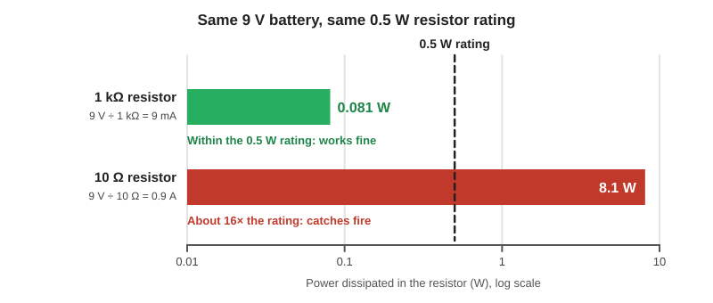

**Higher resistance means lower current.** (Power can also be found with P = V² ÷ R: 9² ÷ 10 = 8.1 W.)

### 8.2 Limiting current for an LED

Red LED (drops about 2 V) on a 9 V battery:

| Resistor | Current | Across LED | Across resistor | Power in resistor | Result |
|---|---|---|---|---|---|
| **470 Ω** | (9 − 2) ÷ 470 ≈ **15 mA** | ≈ 2 V | ≈ 7 V | ≈ 0.1 W | LED **bright** |
| **10 kΩ** | (9 − 2) ÷ 10,000 ≈ **0.7 mA** | ≈ 2 V | ≈ 7 V | ≈ 0.005 W | LED **very dim** |

- The LED still drops about **2 V** and the resistor about **7 V** in both cases. The resistor only limits **how many electrons flow**.
- **Before or after the LED?** It makes **no difference**. It is a single series loop, so the same current flows through both parts.

### 8.3 An LED dimmer (potentiometer as a rheostat)

A 470 Ω resistor and the LED, in series with a 1 kΩ potentiometer used as a rheostat:

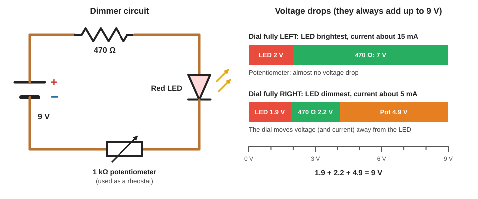

| Dial position | Current | LED | 470 Ω resistor | Potentiometer |
|---|---|---|---|---|
| **Fully left** (LED brightest) | ≈ 15 mA | ≈ 2 V | ≈ 7 V | almost 0 V |
| **Fully right** (LED dimmest) | ≈ 5 mA | 1.9 V | 2.2 V | 4.9 V |

The voltage drops always add up to the supply: 1.9 + 2.2 + 4.9 = **9 V**. Turning the dial moves more of the voltage onto the potentiometer and reduces the current.

### 8.4 Voltage divider

Two resistors **in series** share the voltage. The **same current** flows through both, but each has a different voltage drop and power. Measuring between the two resistors and ground gives a **divided output voltage**.

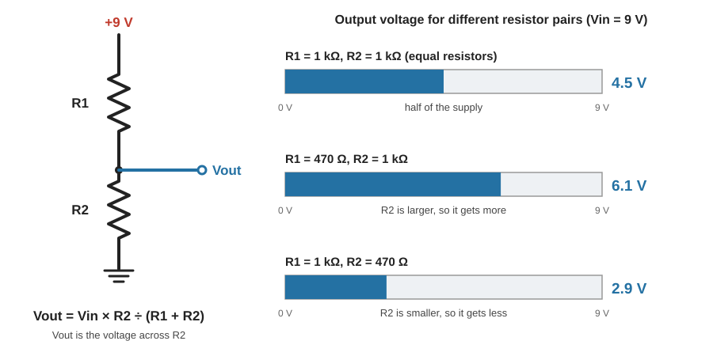

> **Vout = Vin × R2 ÷ (R1 + R2)**

| R1 (top) | R2 (bottom) | Vout (Vin = 9 V) |
|---|---|---|
| 1 kΩ | 1 kΩ | **4.5 V** (half) |
| 470 Ω | 1 kΩ | **≈ 6.1 V** |
| 1 kΩ | 470 Ω | **≈ 2.9 V** |

Swapping the two resistors changes the output. You can also replace one resistor with a **potentiometer**: the dial uses just part of the track, so you get just part of the voltage drop.

### 8.5 Current divider

Resistors **in parallel** share the current.

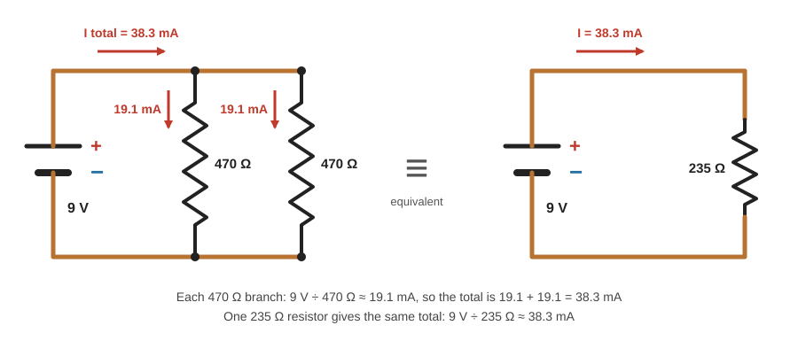

| Circuit (9 V) | Current |
|---|---|
| One 470 Ω resistor | 9 ÷ 470 ≈ **19.1 mA** |
| Two 470 Ω resistors in parallel | 19.1 mA each, **38.3 mA total** |
| One 235 Ω resistor (equivalent) | 9 ÷ 235 ≈ **38.3 mA** |

The **total current and power are the same** for two 470 Ω in parallel or one 235 Ω. With the parallel pair, the current and power are **shared** between the two resistors.

---

## Quick Recap

- A resistor **limits current** by turning energy into **heat**. It works like a **traffic jam**, restricting how many electrons flow.
- **Ratings:** resistance, tolerance, **power**, and voltage. Exceed the power rating and it **burns**. Bigger body = higher power rating.
- **Fixed:** carbon composite (rare now), **carbon film** (cheap, 4 bands), **metal film** (precise, 5 bands), **wirewound** (high power), **SMD** (compact, low power).
- **Film resistors:** the **helical groove** sets the value. More turns = longer, thinner path = higher resistance.
- **Read values:** colour bands (digits, multiplier, tolerance), SMD number codes (**R = decimal point**), or measure with a multimeter.
- **Variable:** **potentiometer** (3 pins: divider, or 2 pins: rheostat), trimmer, **rheostat** (large currents, in series).
- **Automatic and special:** fusible, varistor, thermistor (NTC/PTC), RTD, LDR, strain gauge.
- **In circuits:** current limiting (I = V ÷ R), power (P = V × I or V² ÷ R), **voltage divider** (Vout = Vin × R2 ÷ (R1 + R2)), and current divider (parallel).

---

**Source:** [Resistors Explained (The Engineering Mindset)](https://youtu.be/DYcLFHgVCn0?si=rfnG_ltWpnRIF6Fv)
