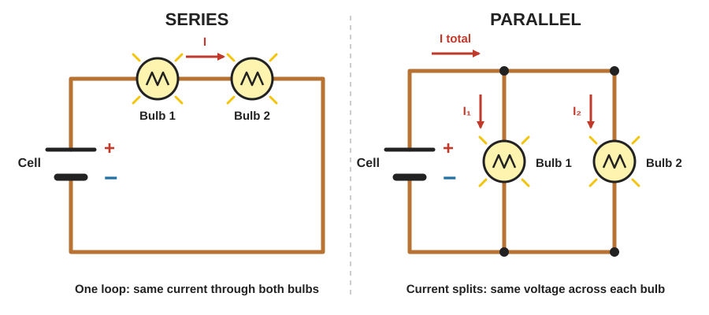
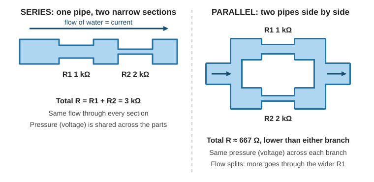
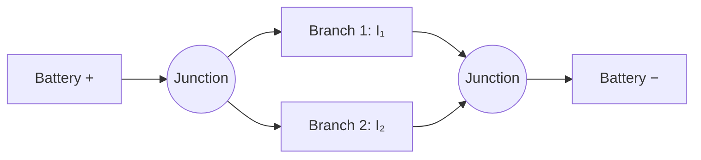
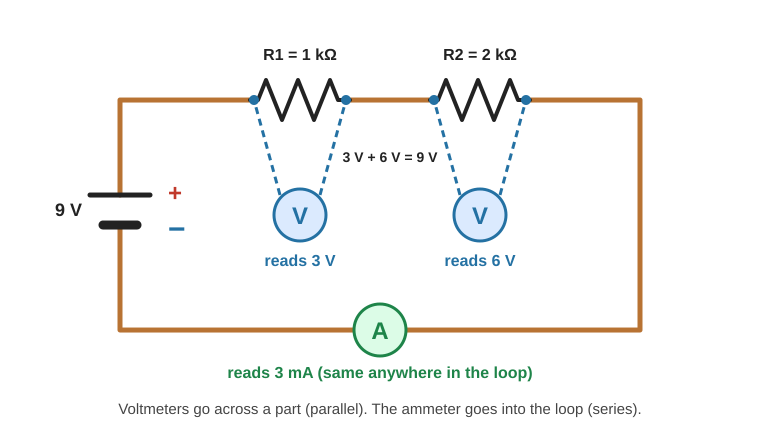
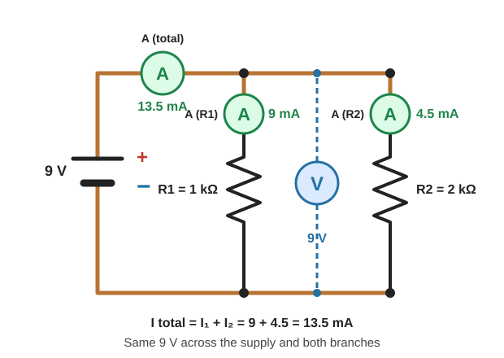
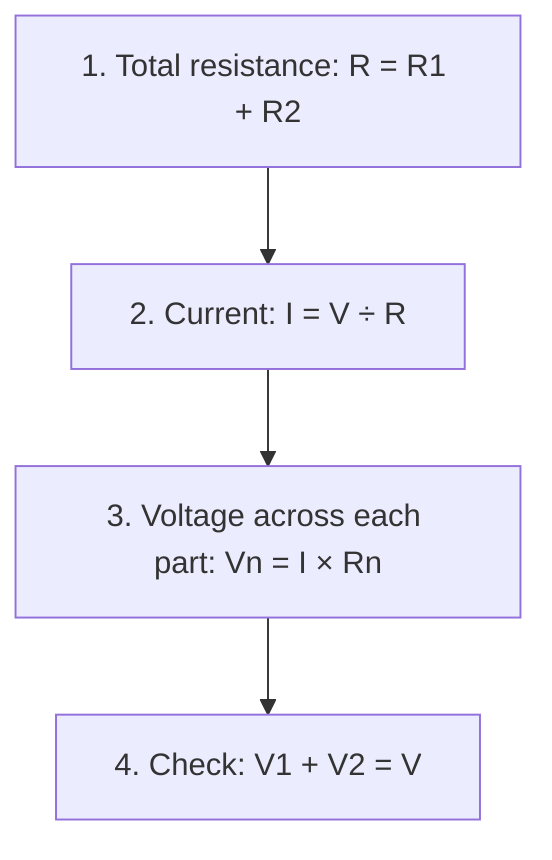
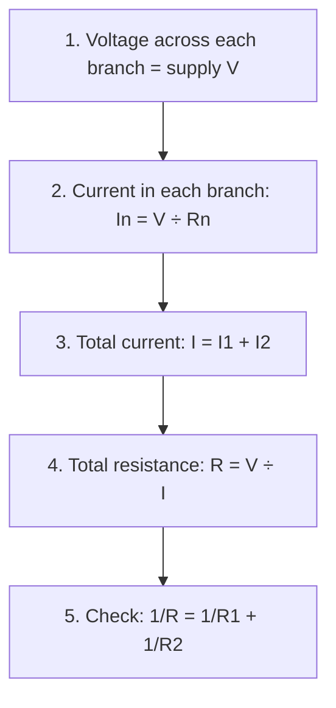

# Series & Parallel Circuits

> **In one line:** In a **series** circuit, parts are connected end to end in a single loop. In a **parallel** circuit, parts are connected side by side, so the current splits. Each type has its own rules for voltage, current, and resistance, and its own way of being measured with a multimeter.

---

## 1. Series vs. Parallel at a Glance

| | **Series** | **Parallel** |
|---|---|---|
| **Layout** | Components end to end, one after another | Components side by side on separate branches |
| **Current paths** | **One** path (a simple loop) | **Two or more** paths |
| **Current** | **Same** through every component | **Splits** between branches |
| **Voltage** | **Shared** between components | **Same** across every branch |
| **Total resistance** | **Sum** of all resistances | **Less than** the smallest resistance |

---

## 2. The Three Quantities (Quick Recap)

| Quantity | Meaning | Unit | Meter | Connects |
|---|---|---|---|---|
| **Voltage (V)** | Electrical "push": joules of energy given to each coulomb of charge | Volts (V) = J/C | Voltmeter | **In parallel** (across the part) |
| **Current (I)** | Flow of charge: coulombs per second | Amps (A) = C/s | Ammeter | **In series** (in the path) |
| **Resistance (R)** | Opposition to current flow | Ohms (Ω) | Ohmmeter | Component isolated, power off |

**Water analogy:**
- **Voltage** is the force pushing the water (current) around.
- **Resistance** is like the pipe narrowing: the narrower it is, the harder it is for water to flow.

---

## 3. Series Circuits

Components are connected end to end, forming **one loop** for the current.

### Rules

| Quantity | Rule | Formula |
|---|---|---|
| **Current** | Same through every component | I = I₁ = I₂ = … |
| **Voltage** | Supply voltage is shared between components | V = V₁ + V₂ + … |
| **Resistance** | Total is the sum | R_total = R₁ + R₂ + … |

- Adding more components in series **increases** total resistance, so **less** current flows.
- **Cells in series add their voltages.** Four 1.5 V cells give 4 × 1.5 = **6 V**.

---

## 4. Parallel Circuits

Components are on **separate branches**, so the current divides.

### Rules

| Quantity | Rule | Formula |
|---|---|---|
| **Voltage** | Same across every branch | V = V₁ = V₂ = … |
| **Current** | Total is the sum of the branch currents | I_total = I₁ + I₂ + … |
| **Resistance** | Total is **less than the smallest** resistor | 1/R_total = 1/R₁ + 1/R₂ + … |

- Adding more branches **decreases** total resistance, so **more** total current flows.

---

## 5. Combining Resistors

### Series
> **R_total = R₁ + R₂ + …**

Example: 3 Ω + 3 Ω = **6 Ω**

### Parallel
> **1 ÷ R_total = 1 ÷ R₁ + 1 ÷ R₂ + …**

**Example 1:** two 3 Ω resistors in parallel

| Step | Working |
|---|---|
| Add the reciprocals | 1/R = 1/3 + 1/3 = 2/3 |
| Flip | R = 3/2 = **1.5 Ω** |

**Example 2:** 10 Ω and 5 Ω in parallel

| Step | Working |
|---|---|
| Add the reciprocals | 1/R = 1/10 + 1/5 = 1/10 + 2/10 = 3/10 |
| Flip | R = 10/3 ≈ **3.33 Ω** |

The same two resistors give **6 Ω** in series (3 + 3) but only **1.5 Ω** in parallel.

**Handy shortcuts (parallel):**

| Case | Shortcut |
|---|---|
| Two resistors | R = (R₁ × R₂) ÷ (R₁ + R₂) |
| N equal resistors | R = R ÷ N (for example, two 3 Ω → 1.5 Ω) |

---

## 6. Measuring with a Multimeter

### 6.1 Setup

| Measurement | Black lead | Red lead | Dial setting |
|---|---|---|---|
| **Voltage** (battery/DC circuits) | COM | V / Ω jack | DC volts (V with a straight line) |
| **Current** | COM | A or mA jack | DC amps (A or mA) |
| **Resistance** | COM | V / Ω jack | Ohms (Ω) |

*Jack and dial labels vary slightly between meters. Check yours.*

### 6.2 The key rules

| Measuring | Connect the meter | How | Power |
|---|---|---|---|
| **Voltage** | **In parallel** (across the part) | Touch the probes to the two ends of the component | **On** |
| **Current** | **In series** (in the path) | **Break** the circuit and insert the meter so current flows *through* it | **On** |
| **Resistance** | **Across the component, on its own** | Remove or isolate the component first | **Off** |

> ⚠️ **Common mistakes to avoid**
> - **Never connect an ammeter across a battery or component (in parallel).** It acts almost like a wire, creating a short circuit that can blow the meter's fuse or damage the circuit.
> - **Move the red lead back to the V / Ω jack** after measuring current. Leaving it in the A or mA jack while measuring voltage can blow the fuse.
> - **Start with a higher range** if your meter isn't auto-ranging, and never measure current above the meter's rating.
> - A **negative reading** just means the leads are reversed. It is harmless for voltage.

### 6.3 Series circuit: what to measure and expect

Example circuit: **9 V** battery, **R1 = 1 kΩ** and **R2 = 2 kΩ** in series.

| To find | How to connect | Expected reading |
|---|---|---|
| **Supply voltage** | Voltmeter across the battery | **9 V** |
| **Voltage across R1** | Voltmeter across R1 | **3 V** |
| **Voltage across R2** | Voltmeter across R2 | **6 V** |
| **Circuit current** | Ammeter inserted anywhere in the loop | **3 mA** (same at every point) |
| **R1, R2 resistance** | Power off, isolate each, ohmmeter across it | **1 kΩ**, **2 kΩ** |
| **Total resistance** | Power off, battery disconnected, ohmmeter across the whole string | **3 kΩ** |

**Checks:** V₁ + V₂ = 3 + 6 = 9 V ✔ and the current is the same everywhere ✔

### 6.4 Parallel circuit: what to measure and expect

Same parts, now in parallel: **9 V** battery, **R1 = 1 kΩ** and **R2 = 2 kΩ**.

| To find | How to connect | Expected reading |
|---|---|---|
| **Supply voltage** | Voltmeter across the battery | **9 V** |
| **Voltage across R1 or R2** | Voltmeter across that branch | **9 V** (the same) |
| **Current in R1** | Ammeter inserted in R1's branch | **9 mA** |
| **Current in R2** | Ammeter inserted in R2's branch | **4.5 mA** |
| **Total current** | Ammeter inserted in the main line (before the split) | **13.5 mA** |
| **Total resistance** | Power off, battery disconnected, ohmmeter across the pair | **≈ 667 Ω** |

**Checks:** I₁ + I₂ = 9 + 4.5 = 13.5 mA ✔ and the total (667 Ω) is below the smallest resistor (1 kΩ) ✔

> **Resistance in parallel:** with the battery disconnected, each resistor *still* reads about 667 Ω when measured in place, because the other branch is also connected across the meter. To read one resistor on its own, **lift one of its legs** from the circuit.

> Real resistors have a **tolerance** (often ±5%), so expect readings slightly off from the calculated values.

---

## 7. Calculating Each Circuit

Use the same worked example: **V = 9 V, R1 = 1 kΩ, R2 = 2 kΩ.**

### 7.1 Series: step by step

| Step | Formula | Calculation | Result |
|---|---|---|---|
| 1. Total resistance | R = R₁ + R₂ | 1 kΩ + 2 kΩ | **3 kΩ** |
| 2. Current | I = V ÷ R | 9 V ÷ 3,000 Ω | **3 mA** |
| 3. Voltage across R1 | V₁ = I × R₁ | 0.003 A × 1,000 Ω | **3 V** |
| 3. Voltage across R2 | V₂ = I × R₂ | 0.003 A × 2,000 Ω | **6 V** |
| 4. Check | V₁ + V₂ | 3 + 6 | **9 V** ✔ |
| Power in R1 | P = V × I | 3 V × 0.003 A | **9 mW** |
| Power in R2 | P = V × I | 6 V × 0.003 A | **18 mW** |
| Total power | P = V × I | 9 V × 0.003 A | **27 mW** (= 9 + 18 ✔) |

### 7.2 Parallel: step by step

| Step | Formula | Calculation | Result |
|---|---|---|---|
| 1. Voltage | V₁ = V₂ = V | | **9 V** each |
| 2. Current in R1 | I₁ = V ÷ R₁ | 9 V ÷ 1,000 Ω | **9 mA** |
| 2. Current in R2 | I₂ = V ÷ R₂ | 9 V ÷ 2,000 Ω | **4.5 mA** |
| 3. Total current | I = I₁ + I₂ | 9 + 4.5 | **13.5 mA** |
| 4. Total resistance | R = V ÷ I | 9 V ÷ 0.0135 A | **≈ 667 Ω** |
| 5. Check | 1/R = 1/R₁ + 1/R₂ | 1/1000 + 1/2000 = 0.0015 | R = **667 Ω** ✔ |
| Power in R1 | P = V × I | 9 V × 0.009 A | **81 mW** |
| Power in R2 | P = V × I | 9 V × 0.0045 A | **40.5 mW** |
| Total power | P = V × I | 9 V × 0.0135 A | **121.5 mW** (= 81 + 40.5 ✔) |

All power values are below the **250 mW (1/4 W)** rating of a standard hobby resistor.

### 7.3 Same parts, different results

| | Series | Parallel |
|---|---|---|
| Total resistance | 3 kΩ | ≈ 667 Ω |
| Total current | 3 mA | 13.5 mA |
| Voltage across R1 | 3 V | 9 V |
| Voltage across R2 | 6 V | 9 V |
| Total power | 27 mW | 121.5 mW |

The parallel arrangement draws **4.5× the current and power** from the same battery.

---

## 8. Comparing Series and Parallel in Practice

| Situation | Series | Parallel |
|---|---|---|
| **One bulb burns out** | The loop is broken, so **all** bulbs go out | The other branches keep working |
| **Brightness** (identical bulbs) | Each gets only a share of the voltage, so they are **dimmer** | Each gets the full supply voltage |
| **Battery drain** | Lower current, lasts longer | Higher total current, drains faster |
| **Typical use** | Fuses and switches (placed in series with what they control), strings of parts that must share the voltage | Household and vehicle lighting and outlets, where each device needs the full supply voltage |

---

## 9. Practice Problems

| # | Question | Answer |
|---|---|---|
| 1 | Each cell provides 1.5 V. What is the voltage of **four cells in series**? | 4 × 1.5 = **6 V** (a voltmeter across all four reads 6 V) |
| 2 | A lamp draws 0.20 A and a resistor draws 0.10 A, **in parallel**. What does an ammeter in the main line read? | 0.20 + 0.10 = **0.30 A** |
| 3 | Two 3 Ω resistors in parallel: total resistance? | 1/R = 2/3, so R = **1.5 Ω** |
| 4 | 10 Ω and 5 Ω in parallel: total resistance? | 1/R = 3/10, so R = **3.33 Ω** |
| 5 | 6 Ω and 3 Ω in parallel across 6 V: find each current and the total. | I₁ = 1 A, I₂ = 2 A, **I = 3 A** (R = 2 Ω) |

---

## Quick Recap

- **Series:** one loop. **Same current**, voltage **shared**, resistances **add**.
- **Parallel:** branches. **Same voltage**, currents **add**, total resistance is **less than the smallest**.
- Parallel formula: **1/R = 1/R₁ + 1/R₂ + …**
- **Voltmeter in parallel. Ammeter in series. Resistance measured with the power off and the part isolated.**
- Calculate series with **R = ΣR, then I = V ÷ R**. Calculate parallel with **I = V ÷ Rn per branch, then add**.
- Always check your results: series voltages add to the supply, parallel currents add to the total.

---

**Source:** [Series and Parallel Circuits (FuseSchool)](https://youtu.be/8Z0jhQeYDUE?si=WIW8bfuSQV2IBVvL)
